# AI 产品经理系统化知识与求职实战手册

> 副标题：从大模型底层原理到产品指标、系统设计、评测治理、作品集与面试表达
>
> 编写日期：2026-10-11
> 知识来源：原始知识库《AI 学习笔记 · 全流程体系化完整版》、用户先后提供的四份产品延伸与基准资料、公开论文与官方文档交叉整理
> 适用对象：准备 AI 产品经理 / AI 应用产品 / Agent 产品 / AI 平台产品岗位的同学；也适合在职 AI PM 做能力自查

---

## 📖 写在前面：这份文档怎么用

你手上的那份知识库解决的是"**这些技术到底是什么**"。但面试官真正想听的不是这个，而是：

> "这个技术原理，在我的产品上表现成什么现象？我用什么指标盯它？我能拧哪些旋钮？拧了之后牺牲了什么？"

这就是本文档要补的那一环。AI 产品经理的真正区分度已经不在于会不会复述术语，而在于能否把概率性的模型能力，变成可验证、可观测、可回退、可持续经营的产品系统。所谓“能做成”，至少包括下面这些能力：

- 能定义什么叫"做成了"（Eval-First）
- 能把模型指标和业务指标连起来
- 能在准确率 / 延迟 / 成本 / 安全之间做取舍并说清理由
- 能设计模型失败时的人机协作与降级路径

> **阅读约定**：文中的“建议阈值”“示例目标”用于展示如何写指标，不是跨业务通用的行业标准。真正上线前，必须用本业务的人类基线、历史数据、失败成本和小流量实验重新校准。模型名称、价格、上下文长度和服务条款会变化，涉及采购决策时应回到厂商最新官方页面。

下面这张图给出全书的逻辑，而不是章节清单。它表达的是：技术不是终点，业务结果才是；指标、体验、工程与治理负责把两端连接起来。

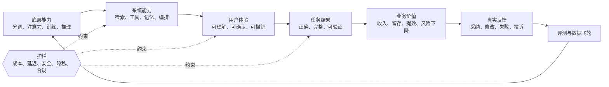

*这张思维导图把全书压缩为“原理、系统、产品、经营、求职”五个知识域；阅读时可以随时回到这里定位自己正在解决哪一层问题。*

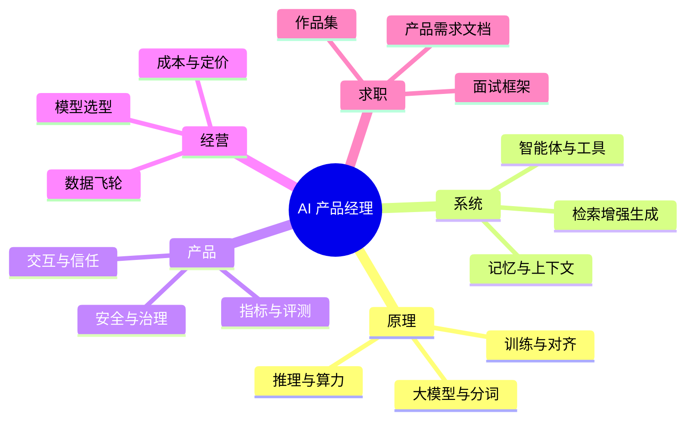

### 四种使用场景

| 场景 | 建议读法 |
|---|---|
| **临考前突击** | 只读第 0 章（方法论）+ 第 11 章（面试题）+ 附录 A（指标字典） |
| **技术面准备** | 第 0 章 + 第 1~3 章 + 第 10 章（按知识库顺序逐条过） |
| **业务面 / 总监面** | 第 0 章 + 第 5、6 章 + 第 8 章 + 第 12 章 |
| **作品集 / 简历打磨** | 第 12 章 + 附录 A + 第 6.1 节（评测体系） |

### 一条阅读纪律

每读一个技术点，逼自己回答完这五个问题再往下走。答不上来，说明这个点你还没真正"产品化"：

1. 这个原理在用户侧表现成什么现象？（一句话，不要术语）
2. 我用哪个指标盯它？口径怎么写清楚？
3. 我有哪些可执行的优化杠杆？按 ROI 排序是什么？
4. 优化它要牺牲什么？（成本 / 延迟 / 质量 / 安全 中的哪几项）
5. 面试官追问"为什么"的时候，我怎么答到第二层？

---

## 📐 第 0 章　通用翻译框架：把技术原理翻译成产品语言

这一章是整份文档的方法论底座。后面十章的所有条目，都是这套框架的反复应用。

### 0.1 五问翻译法（T→P→M→L→T）

任何一个技术点，都可以用下面这条链路完成"原理 → 岗位能力"的转化：

```
T  Technology  技术原理一句话      →   Attention 是按相关性对上下文加权求和
P  Phenomenon  产品现象/用户感知    →   长文档问答时，模型会"看不到"中间的事实
M  Metric      可度量指标          →   长文档定位准确率、中间段证据利用率、Recall@K
L  Lever       优化杠杆（按 ROI）   →   重排把关键证据放头尾 → 压缩无关上下文 → 换长上下文模型
T  Trade-off   权衡与代价          →   压缩省 token 但可能丢证据；换大模型涨成本与 TTFT
```

**关键提醒**：大部分候选人只能答到 T 和 P，一部分能答到 M，能答到 L 和 T 的人极少。而面试官的"加分项"几乎全部落在 L 和 T 上。所以训练的时候，请刻意练后两问。

### 0.2 AI 产品的"四层指标塔"

AI 产品不能只有一层指标。缺任何一层，你的决策都会失真。

```
第 4 层  业务价值层     转化率 / 留存 / 收入 / 人工替代率 / ROI
           ↑ 由下层的"质量×体验"驱动，但会被价格、渠道、时机干扰，噪声最大
第 3 层  用户体验层     任务完成率 / 采纳率 / 重生成率 / 编辑距离 / CSAT / 转人工率
           ↑ 用户真实感受到的那一层，AI 产品最容易被忽略的一层
第 2 层  系统链路层     意图识别准确率 / 工具调用正确率 / 检索 Recall@K / 步骤数 / 恢复率
           ↑ 决定"是哪个环节坏了"，归因靠这一层
第 1 层  模型能力层     准确率 / 幻觉率 / 格式正确率 / 忠实度 / 拒答率 / 一致性
           ↑ 最容易测，也最容易自欺欺人的一层

护栏层（贯穿四层）  安全违规率 / 越权率 / P95 延迟 / 单任务成本 / 敏感信息泄漏率
           ↑ 护栏指标的作用是防止"指标退化"：核心指标上涨但稳定性同步下降
```

**判断标准**：如果你的看板只有第 1 层和第 4 层，中间没有第 2、3 层，你永远不知道用户为什么流失；如果只有第 1~3 层没有成本，你永远算不清商业账。

为了便于真正落到看板和产品需求文档，可以把四层再展开成六层。四层塔适合面试时快速回答，六层树适合项目治理，两者并不矛盾。

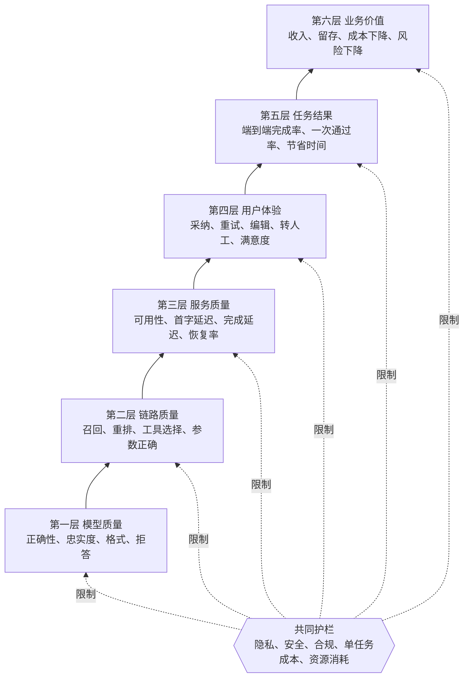

**从指标树到经营账的三条公式**：

1. **有效任务完成率** = 经外部判定完成的任务数 ÷ 发起任务数。这里的“外部判定”可以是用户确认、数据库状态、测试通过或人工审核，不能只让模型自己宣布完成。
2. **单次成功任务成本** = 一段时间内的模型调用、检索、工具、基础设施与人工复核总成本 ÷ 同期成功任务数。只看“单次调用成本”会奖励便宜但频繁失败的方案。
3. **增量投资回报率** =（上线后的增量收益 + 节约成本 − 新增运行与治理成本）÷ 新增运行与治理成本。增量收益要和对照组或上线前基线比较，不能把自然增长都算给人工智能功能。

**服务目标与误差预算**：服务级目标不是“永不失败”，而是约定某个周期内可接受的可靠性。例如，月度端到端成功率目标是 99%，就意味着有 1% 的误差预算。预算消耗过快时暂停功能扩张，优先修复可靠性；预算充足时才允许更积极的实验。这样的机制能把“稳定性很重要”变成可执行的发布规则。[^slo]

#### 从指标到动作：十二个可控旋钮

产品经理不能直接要求“模型更聪明”，但可以改变系统输入、工具、路径、风险边界与商业规则。下面十二个旋钮回答的是：指标异常后，团队到底能改什么。

| 旋钮 | 主要改善 | 常见代价 | 验证方式 |
|---|---|---|---|
| 模型选型与路由 | 质量、成本、延迟 | 路由错误、风格不一致、维护复杂 | 分任务回归与路由混淆矩阵 |
| 提示词与系统规则 | 指令遵循、格式、语气 | 上下文变长、规则冲突 | 提示版本对照实验 |
| 上下文编排 | 证据利用、长任务稳定性 | 压缩丢信息、截断关键约束 | 位置敏感度与消融实验 |
| 检索策略 | 事实性与可追溯 | 检索延迟、噪声、索引维护 | 召回、排序与引用分开评测 |
| 微调与偏好对齐 | 稳定行为、风格和格式 | 数据、训练、回归与迁移成本 | 同一黄金评测集前后对照 |
| 工具与技能编排 | 可执行任务范围 | 步数、权限和失败点增加 | 工具选择、参数和端到端成功率 |
| 人工确认关卡 | 高风险动作安全性 | 等待与人工成本 | 事故率、误拦率、确认后完成率 |
| 推理服务参数 | 吞吐、显存和单位成本 | 高峰延迟或潜在质量损失 | 压测曲线与质量回归 |
| 缓存和批处理 | 输入成本、离线吞吐 | 新鲜度、等待与存储成本 | 命中率、误命中率、完成时限 |
| 输出与交互形态 | 感知延迟、信任、采纳 | 界面和状态管理复杂 | 可用性测试与线上行为指标 |
| 评测、埋点和追踪 | 归因、回归与决策速度 | 建设与标注成本 | 归因覆盖率、发现与修复时长 |
| 定价与用量规则 | 毛利、转化和资源公平 | 限额影响体验，无限额侵蚀毛利 | 分层单位经济与价格实验 |

使用时不要一次拧多个旋钮。先确定主要瓶颈，改动一个主要变量，记录版本，在同一评测集和线上护栏下验证；否则即使指标上升，也很难知道究竟是哪项改变生效。

### 0.3 北极星指标怎么写：不要写"AI 使用量"

“人工智能调用次数”“人工智能使用人数”是最常见也最没用的北极星。正确的写法是：

> **北极星 = 成功任务数 × 质量系数**

| 产品形态 | 更可信的北极星 |
|---|---|
| AI 写作工具 | 周采纳输出数（被用户保留/使用的成稿） |
| AI 客服 Copilot | AI 辅助下解决的工单量（不是"AI 回复的工单量"） |
| AI 搜索 | 成功回答会话数（用户拿到可信答案且停止搜索） |
| AI 编程助手 | 被接受并合入的 AI 生成代码变更 |
| AI 文档助手 | 一次通过、无需人工大改的交付物数量 |
| Agent 产品 | 自主完成且经外部验证器确认的任务数 |

**共同点**：都是"用户真的用了这个结果"，而不是"AI 说了点什么"。

### 0.4 二十组高频权衡对（背下来，面试随时能用）

| # | A 侧 | B 侧 | 典型决策场景 | 我的建议默认值 |
|---|---|---|---|---|
| 1 | 准确率 | 覆盖率/拒答率 | 问答产品是否允许"不知道" | 高风险场景宁可拒答 |
| 2 | 质量 | 成本 | 模型选型 | 先定质量下限，再找最便宜的达标方案 |
| 3 | 质量 | 延迟 | 是否上大模型/长思考 | 交互式场景 TTFT 优先 |
| 4 | 吞吐 | 单请求延迟 | 是否开大批处理 | TTFT 当 SLO，在其约束下追吞吐 |
| 5 | 上下文完整 | Token 成本 | 历史对话全量回灌 vs 摘要 | 摘要 + 关键原文保头尾 |
| 6 | 召回量 | 噪声/注意力稀释 | RAG Top-K 设多少 | 先广召回 50~100，rerank 到 5~10 |
| 7 | 忠实度/可溯源 | 有用性/综合度 | RAG 是照抄还是综合 | 高风险领域严 groundedness |
| 8 | 自动化程度 | 可控性/信任 | 智能体自治级别 | 从只读建议或确认后执行开始，按任务风险渐进授权 |
| 9 | 权限开放度 | 安全风险 | MCP 工具接多少 | 最小权限 + 高风险动作白名单 |
| 10 | 多 Agent 并行 | token 成本/一致性 | 是否拆角色 | 无并行、无独立验证器就不拆 |
| 11 | 微调定制效果 | 迭代速度/维护成本 | 是否微调 | Prompt → RAG → 微调，逐级升级 |
| 12 | 端侧隐私 | 模型能力 | 端侧 vs 云侧 | 敏感场景端侧，重任务云侧 |
| 13 | 开放权重自部署 | 运维成本 | 开源 vs API | 未过算力盈亏点前用 API |
| 14 | 输出多样性 | 一致性/可复现 | temperature 设置 | 生产环境默认低温 |
| 15 | 长思考/推理 | 延迟与成本 | 是否开 reasoning | 按任务难度路由 |
| 16 | 记忆个性化 | 隐私与上下文膨胀 | 记忆写什么 | 显式 + 可查看 + 可删除 |
| 17 | 实时联网 | 稳定性/成本/注入风险 | 是否默认开联网 | 按需检索，不默认全开 |
| 18 | 缓存命中率 | 答案新鲜度 | 语义缓存阈值 | 用误命中成本校准相似度，并设置短有效期与抽样审计 |
| 19 | 内容丰富度 | AI 味/品牌一致性 | 输出风格控制 | 建立风格评分 rubric |
| 20 | 上线速度 | 评测完备度 | MVP 节奏 | Eval-First，但 eval 集可以小（100~300） |

### 0.5 面试答题模板：T-S-Q-C-R 五段式

面对"你怎么设计/优化/评估 XX"这类开放题，用这个结构，30 秒出框架：

- **T（Task framing，先框定任务）**：先复述并澄清场景——"我先确认一下，这是面向 C 端用户的实时问答，还是内部员工的知识检索？两者的失败成本完全不同。"
- **S（Success definition，定义成功）**："在这个场景下，我认为成功 = 用户在 X 秒内拿到带引用的答案，且不需要二次追问。"（**这一步是区分度最高的**，很多人直接跳到方案）
- **Q（Quality metrics，三层指标）**：给出 2~3 个核心指标 + 1~2 个护栏指标，并说明口径。
- **C（Constraints & trade-off，约束与取舍）**：明确点出你会牺牲哪一项、为什么。
- **R（Rollout & rollback，灰度与回退）**：怎么上线、怎么监控、出问题怎么退。

**加分话术**（在结尾补一句，能显著提升"资深感"）：
> “另外我会先建立一套小而有代表性的黄金评测集，覆盖正常路径、边界样本、不可回答问题、历史坏例和对抗样本；高风险场景增加对抗与越权样本。没有这个基线，我无法判断任何一次优化是变好还是变差。”

### 0.6 三个"反问式"加分动作

在回答完之后，主动抛出下面任意一句，能把对话从"答题"拉到"讨论"：

1. **问失败成本**："这个场景里，一次错误答案的代价是什么？是用户弃用，还是合规事故？这决定了我们的护栏阈值设在哪。"
2. **问基线**："我们现在有人类专家做这件事的基线数据吗？没有基线的话，我无法判断 AI 是在提效还是在增加返工。"
3. **问口径**："我们说的成功率，是按单轮算还是按端到端任务算？一个 12 步的工作流，单步 95% 成功率，端到端只有 54%。"

第三句尤其好用。它背后是一个真实且反直觉的数学事实：**95% 的单步成功率 ≠ 95% 的端到端成功率**（0.95^12 ≈ 54%）。这句话一出口，面试官对"这个人做过 Agent"的判断基本就成立了。

### 0.7 人工智能产品区别于传统软件的七个本质差异

| 差异 | 底层原因 | 产品经理必须增加的动作 |
|---|---|---|
| 输出是概率分布 | 生成过程与输入表达都会影响结果 | 多次运行、看分布、设计失败兜底 |
| 质量、延迟与成本强耦合 | 更长输入、更强模型、更多步骤同时增加计算 | 每个方案同时报价三项，不只报准确率 |
| 使用越多，推理变动成本越高 | 每次请求都消耗计算与外部服务 | 监控每成功任务成本和单位经济 |
| 开放输出缺少唯一标准答案 | 写作、总结、研究等任务存在多种可接受结果 | 规则、外部验证器、模型评审与人工抽检组合 |
| 能力边界由外部供应持续改变 | 模型、价格、条款与接口会升级 | 锁定版本、回归评测、供应商退出方案 |
| 长期壁垒来自真实反馈闭环 | 通用底座容易被竞争者获得 | 从第一天记录采纳、修改、失败和投诉原因 |
| 安全问题会改变外部世界 | 智能体可能读敏感数据并执行写操作 | 最小权限、人工确认、幂等、审计和回滚前置 |

一句话概括：传统软件产品经理主要管理确定性功能的可用性；人工智能产品经理还要管理概率系统的期望、方差、失败成本和授权边界。

---

## 🧠 第 1 章　模块一 · 大模型基础 × 产品延伸

### 1.1 模型参数与文件格式（GGUF / Safetensors / 量化）

**原理一句话**：模型参数是海量浮点数，训练完序列化成文件；不同格式决定了它能在什么硬件上、以什么精度跑起来。7B~8B 的 FP16 约 13~14GB，4-bit 量化后约 4~5GB。

**产品现象**：这直接决定了你的产品是"云端 API"、"私有化部署"还是"端侧本地跑"。用户感知到的差异是：**是否能离线用、数据是否出域、首次加载多久、响应速度如何**。

**核心指标**

| 指标 | 口径 | 说明 |
|---|---|---|
| 冷启动加载时长 | 从进程启动到首个 token 可用 | 端侧产品的一号体验杀手 |
| 单机可承载并发 | 在目标硬件上稳定服务的并发数 | 由显存（权重 + KV Cache）决定 |
| 量化前后质量差 | 同一 golden set 上的准确率 delta | 必须测，不能凭感觉 |
| 数据出域比例 | 走本地推理的请求占比 | 金融/医疗/政务的合规硬指标 |
| 单位任务能耗/成本 | 端侧看电量与发热，云侧看 GPU 时 | 端侧产品的隐藏体验指标 |

**优化杠杆（按 ROI 排序）**
1. **先定义质量下限**：量化前先锁定“量化后准确率下降到什么程度仍可接受”，带着这个阈值去选量化位宽。不同模型、硬件与任务对量化的敏感度不同，不能把某个位宽当成普遍安全线。
2. **权重/激活/KV 分级量化**：只量化权重（weight-only）风险最低；KV Cache 量化能显著缓解长上下文显存压力，但要单独验证长文档任务。
3. **把量化当成一个"路由维度"而非全局开关**：高风险的复杂任务走全精度路径，高容量的简单/缓存路径走量化路径。
4. **给端侧设计"能力降级清单"**：明确告诉用户离线时哪些功能不可用，而不是静默变差。

**权衡与坑**
- 量化的质量损失是**静默的**——没有校准过的评测集，它会以"感觉变差了"的形式在几周后浮现。
- 4-bit 让"能装下"变成可能，但"能装下"不等于"跑得动"（显存带宽、KV Cache 仍可能卡死）。
- 端侧不是万能隐私解：模型在你设备上 ≠ 你的 prompt 不上报；**必须把遥测策略写进隐私说明**。

**面试话术示例**
> "如果我们要做端侧，我会先问三个问题：目标机型的最低内存是多少、离线时哪些能力可以没有、量化后质量掉多少算不可接受。然后我会用这三个答案反推：能不能用 4B 量化 + 云端兜底路由，而不是一上来追求 8B 本地跑。我们的 SLO 应该是'95% 的请求在端侧完成，5% 复杂请求 2 秒内切云端'，而不是'100% 端侧'——后者会把硬件门槛和成本都抬到一个不现实的位置。"

### 1.2 Tokenizer：为什么 PM 必须懂它

**原理一句话**：Tokenizer 把文本切成 token（模型计算的最小单位），影响词表大小、压缩率、多语言效果、API 费用、Prefill 计算量和 KV Cache 占用。BPE 是从字符不断合并高频相邻对得到词表。

**产品现象**：**语言成本不对称**。同一个功能，中文用户的 token 消耗通常高于英文，直接体现在单位成本和延迟上；中文在部分词表下压缩率低，意味着同样的字数吃掉更多上下文预算。

**核心指标**

| 指标 | 口径 | 用途 |
|---|---|---|
| 压缩率（chars/token） | 字符数 ÷ token 数 | 估算成本与上下文占用 |
| 单次请求 token 分布 | P50 / P95 / P99 | 定价、限流、上下文预算 |
| 中英文成本比 | 同语义任务的中/英 token 消耗比 | 国际化产品的定价模型 |
| 截断率 | 超长被截断的请求占比 | 长文档功能的可用性红线 |
| 特殊 token/格式损耗 | 结构化模板占用的固定 token | Prompt 预算优化空间 |

**优化杠杆**
1. **建立"token 预算表"**：像管理数据库字段一样管理你的上下文构成——系统提示 X token、工具定义 Y token、历史摘要 Z token、检索证据上限 W token。每次改动都要看这张表。
2. **固定前缀版本化**：系统提示与工具定义放在最前、保持不变，是命中 prefix cache 的前提（见 3.9）。
3. **输出长度也要管**：设置 max_tokens 上限 + 合理 stop 序列，输出 token 通常比输入贵，而且是串行生成的。
4. **多语言成本可视**：在成本看板里按语言维度拆分，避免"中文用户补贴英文用户"的定价坑。

**权衡与坑**
- 缩减 prompt 是最便宜的优化，但**过度压缩会让系统提示变成"互相打架的咒语"**（见 3.10 的 haunted system prompt）。
- 不要把"减少 token"当成目的，要把"减少**无信号** token"当成目的。
- 计费口径（是否含缓存读、是否含工具输出）各家不同，报价前必须确认。

**面试话术示例**
> "我会把 token 当成产品的单位成本来管理。具体做法是给每个功能建一张 token 预算表，包括输入/输出/缓存命中三部分，然后按 session、user、endpoint 三个维度拆成本——只看月度 API 账单是发现不了问题的，往往是某个 endpoint 在悄悄烧钱。我们也发现很多团队一上来就调 kernel、换引擎，但最便宜的优化其实永远是'少算 token'。"

### 1.3 Q/K/V 与 Attention：映射到"相关性"产品

**原理一句话**：查询向量 Q（我在找什么）与键向量 K（这里有什么标签）计算相关性权重，再用它加权值向量 V（真实信息），得到融合上下文的新表示并预测下一个词元。Q、K、V 是每次前向计算由隐藏状态与参数矩阵相乘得到的，不是模型参数里预存的固定内容。[^attention]

**产品现象**：模型的"理解"本质是**按相关性做加权聚合**。所以：
- 喂进去的东西越相关，输出越准（→ 上下文工程的价值）
- 喂进去的噪声会**真实地抢走注意力**（→ 为什么"多给点资料"反而变差）
- 同一段内容放在不同位置，被利用的程度不同（→ lost in the middle）

**核心指标**

| 指标 | 口径 | 说明 |
|---|---|---|
| 上下文相关率 | 进入上下文的片段中，被判定为与当前问题相关的比例 | 上下文工程的核心质量指标 |
| 证据利用率 | 回答中实际引用的证据条数 ÷ 提供的证据条数 | 太低说明噪声太多 |
| 位置敏感度 | 关键证据放在头/中/尾时的准确率差异 | 用于决定证据摆放规则 |
| 输出可归因率 | 回答中的事实性陈述能追到具体来源的比例 | 高风险问答的核心护栏 |

**优化杠杆**
1. **减少进入上下文的东西**，而不是增加。这条是所有优化里收益最高的。
2. **重排（rerank）**：先广召回 50~100 条，再用 cross-encoder 重排到 5~10 条，把最相关的放在**最后**（靠近当前指令，处于高注意力区）。
3. **结构化标题 + 编号**：让模型更容易定位和引用，也让"引用正确率"可测。
4. **可解释性产品化**：把“这条答案来自哪份文档的哪一段”做成用户界面元素，而不是只在后台日志里。操作与证据面板能帮助用户校验结果，但是否提升确认率、降低转人工率必须通过本产品的对照实验验证。

**权衡与坑**
- 可解释 ≠ 让用户看思维链。展示"依据 + 置信度 + 可逆操作"比展示 raw CoT 更有效，也更安全（CoT 可能包含不该暴露的内容，且会诱导用户过度信任）。
- 不要直接用模型自报的"我有 X% 把握"。研究显示强化学习训练出的模型存在**过度自信**问题：自信地胡说和自信地答对，在输出 token 上几乎不可区分。置信度应该用外部信号估计——检索相关度分数、工具调用成功率、多模型投票一致性等。

**面试话术示例**
> "Attention 直接告诉我一件事：进入上下文的每一段内容都在真实地争夺模型的注意力预算。所以我的优化顺序永远是先做减法——砍掉无关上下文、重排、压缩历史——再考虑换更强的模型。这也是为什么我特别看重'上下文相关率'这个指标，它比单纯的准确率更能指导行动，因为准确率高但相关率低，说明是模型在靠参数硬扛，我们的产品还没真正提供价值。"

### 1.4 多层 / 多头：能力分层与模型选型

**原理一句话**：多层让信息逐步抽象（底层字词 → 中层句法语义 → 高层任务意图）；多头让同一 token 同时从多个角度观察上下文。

**产品现象**：能力不是均匀的。同一个模型可能在"改写文案"上很强，但在"多步数值推理"上很弱。**这就是"模型能力矩阵"存在的原因**。

**核心指标**：分任务类型成功率（不要只报一个总成功率）、能力退化率（新版本在旧强项上的回退）、任务-模型匹配命中率（路由准确率）。

**优化杠杆**
1. **建"模型能力矩阵"文档**：记录不同模型在你们产品场景下的实测数据，按任务类型（摘要/抽取/推理/生成/分类/工具调用）分列，定期更新。这是 AI PM 最该维护的一份资产。
2. **按任务路由而不是按用户路由**：同一个用户会话里，意图识别走小模型，复杂生成走大模型。
3. **升级模型时跑回归集**，不要只看新模型在新任务上的表现，**老强项的回退更致命**。

**权衡**：路由带来工程复杂度与一致性风险（不同模型风格不一致）。缓解办法是把"风格"交给系统提示统一约束，把"能力"交给路由。

### 1.5 长上下文与"中间遗忘"（lost in the middle）

**原理一句话**：长窗口不等于模型会同等利用所有位置。研究显示，在一些长上下文任务中，开头和结尾的信息更容易被利用，中间信息的表现较弱；具体程度随模型和任务变化，必须实测。[^lost_middle]

**产品现象**：用户上传一份 200 页合同问第 87 页的一个条款，模型答非所问；或者你在系统提示第 347 行写的一条规则，模型从未执行。

**核心指标**

| 指标 | 口径 |
|---|---|
| 长文档定位准确率 | 按"答案所在位置（前/中/后）"分组统计的准确率 |
| 中间段证据利用率 | 关键证据位于上下文中部时的正确引用率 |
| 上下文长度-准确率曲线 | 不同输入长度下的准确率衰减曲线（找到你的"真实可用窗口"） |
| 系统规则执行率 | 系统提示中每条规则的实际遵守率（抽样 + 人工判定） |

**优化杠杆**
1. **证据摆放规则**：关键证据放头尾；如果检索到 5 条，最相关的放最后。
2. **检索优于全量**：长文档不要整篇塞进去，用 RAG 只召回相关片段。
3. **滚动压缩**：长会话不要全量回灌历史，定期把较早部分摘要成紧凑叙述替换掉。
4. **系统提示"审计"**：像审代码一样审规则，删除矛盾项。一个 400 token 无矛盾的系统提示，几乎总是优于一个 4000 token 内部打架的系统提示。
5. **把"能处理多少页"当成可测承诺**，而不是照抄模型宣传的窗口大小。研究普遍发现，模型在远未达到标称窗口上限时就开始不稳定。

**权衡**：压缩词元能降低成本但可能丢失约束；不压缩则历史、工具返回和中间结果会随步骤累积，成本与延迟持续增长。长程任务应记录每轮输入、输出和工具结果的词元分布，用真实轨迹决定何时摘要、何时保留原文。

**面试话术示例**
> "长上下文能力要分两层看：模型标称的窗口是一回事，产品实际可用的窗口是另一回事。我们的做法是测'上下文长度-准确率曲线'，找到衰减拐点，把拐点当成产品的真实能力边界写进文档和营销口径。另外我会把系统提示当代码来管——每条规则有 owner、有版本、有回归测试，因为我们踩过坑：规则越加越多，最后'永远要简洁'和'永远要详尽'同时躺在提示里，模型只能取平均，输出就变成了浆糊。"

### 1.6 预训练 vs 推理：自研 or 采购的决策树

**原理一句话**：训练是"调参数让预测下一个字的误差最小"，产出一个权重文件；推理是加载权重做前向生成，**不改参数**。训练成本极高（数据、算力、时间），推理成本随调用量线性增长。

**产品现象**：这是一切"要不要自研模型"讨论的起点。

**决策树（可直接用于面试）**

```
第 0 问：这个问题，不训练能不能解决？
  ├─ 能（提示词 / 检索增强生成 / 工具）→ 不训练，保留更快迭代能力。
  └─ 不能 → 第 1 问
第 1 问：缺的是"知识"还是"行为"？
  ├─ 缺知识（私域、实时、可引用）→ RAG，不是微调，更不是预训练
  └─ 缺行为（风格、格式、稳定 Schema、领域语言）→ 第 2 问
第 2 问：Prompt 是否已经触及天花板？
  ├─ 没有 → 继续优化 Prompt/上下文
  └─ 是（在可测 eval 上停滞）→ 第 3 问
第 3 问：有没有足够且有代表性的高质量标注样本？
  ├─ 没有 → 先做数据，不要微调
  └─ 有 → 第 4 问
第 4 问：月调用量是否大到能摊平训练成本？
  ├─ 否 → 微调不划算（参考下面的盈亏公式）
  └─ 是 → 微调；再往下才考虑继续预训练 / 从零预训练
```

**盈亏平衡公式**（强烈建议背下这个，面试说数字很加分）：

```
盈亏平衡调用量 = 训练成本 ÷ (微调前单次成本 − 微调后单次成本)
```

计算时必须代入当前供应商价格、真实输入输出长度、训练与评测成本、部署维护成本和预期调用量，并做高、中、低三种流量情景。只有当质量不退化、调用规模稳定且回收周期可接受时，微调的成本优势才成立。

**核心指标**：训练 ROI 回收周期、微调前后 eval delta、模型替换回归通过率、供应商锁定度（可迁移成本）。

**权衡与坑**
- 微调会**失去基座模型自动升级的好处**，且模型会"变 stale"：如果事实变化快，微调反而是负担。
- 微调适合教**行为**，不适合塞**知识**；用微调注入知识是常见误用。
- 不要用固定调用量决定是否微调：盈亏点取决于模型差价、提示词缩短幅度、训练与维护费用、质量回归风险和调用分布。应使用上面的公式做自己的情景分析。

### 1.7 MoE：总参数 ≠ 激活参数，定价要看后者

**原理一句话**：MoE 把参数分成多个专家，每个 token 只路由激活其中少数。必须区分**总参数、每 token 激活参数、实测计算量**。

**产品现象**：专家混合架构使“总参数量”与“单次请求实际计算量”不再等价。也意味着**只看参数量判断模型质量或成本是错误的**。

**核心指标**

| 指标 | 口径 |
|---|---|
| 每百万 token 实际单价 | 按你的真实输入输出分布测算，不用官方示例 |
| 激活参数比 | 激活参数 ÷ 总参数 | 
| 单位任务成本 | 完成一个标准任务的花费（比单价更贴近业务） |
| 单任务耗时 | 端到端 wall-clock（含排队、工具） |

**优化杠杆**
1. **按"标准任务"而非"百万 token"评估成本**：定义你们产品的 3~5 个典型任务，用它们做跨模型成本基准。
2. **警惕"便宜但啰嗦"**：单位 token 便宜的模型如果输出更长、重试更多，全链路成本反而更高。**反直觉但常见的结论是：单价最高的模型往往全链路成本最低**，因为一次成功率高、重试少、人工复核少、错误修正少。
3. **完整成本公式**（面试写出来很有说服力）：

```
每个成功任务的真实成本 =(
    API 调用成本（输入×单价 + 输出×单价）
  + 重试成本（失败率 × 重试次数 × 单次成本）
  + Prompt 工程人力成本
  + 后处理成本（解析/校验/格式化）
  + 人工审核成本（需复核比例 × 复核单价）
  + 错误修正成本（幻觉或错误导致的返工）
) ÷ 成功任务数
```

**权衡**：MoE 模型在极小 batch 下可能反而不如 dense 模型高效；路由不均也会导致部分专家成为瓶颈。这些是工程侧的事，但 PM 要理解：**宣传的"激活参数"不等于你的实测吞吐**。

### 1.8 开源协议（MIT / Apache 2.0 / GPL）：合规就是产品能力

**原理一句话**：MIT 最宽松（保留声明即可闭源商用）；Apache 2.0 宽松且含专利授权；GPL 强 copyleft，衍生作品必须同样开源。

**产品现象**：To B 交付、私有化部署、二次分发、出海，全都卡在这里。

**核心指标**：许可证合规通过率（法务评审）、可分发性（能否交付给客户）、衍生品义务清单、模型卡/数据血缘完整度。

**优化杠杆**
1. **建"模型资产台账"**：每个模型记录来源、协议、版本、用途、是否可分发、是否有商用限制。这是 AI 治理的最小可行单元。
2. **把合规做成产品功能**：AI 生成内容标识、操作审计日志、数据驻留选项、模型版本公告。对金融/医疗/政务客户，**可解释、可审计、可控制往往是能否被采购的前提**。
3. **不要用"大家都在蒸馏"来自我安慰**：蒸馏的合法性取决于授权、服务条款、商业秘密，要法务出意见。

**权衡**：开放权重换来自主可控与数据不出域，代价是自建推理栈的运维、容量和安全成本。是否比托管应用程序编程接口划算，必须用真实利用率、峰谷负载、硬件折旧、人员与故障成本做盈亏分析，不能套固定利用率阈值。

### 1.9 Embedding / 切块：三层"切分"不要混为一谈

**原理一句话**：
- **LLM 输入层**：切分单位是 token，向量是 token embedding + 位置表示
- **RAG 建库层**：切分单位是文档 chunk，向量由**独立的 embedding 模型**生成，用于相似度检索
- **多模态输入层**：图像切 patch、音频切帧，经编码器投影到统一 token 空间

**产品现象**：这是面试里最容易混淆、也最容易加分的一组概念。混淆会导致需求写错——比如"我们把文档切成 512 token 喂给模型"和"我们把文档切成 512 token 建向量库"是完全不同的两件事。

**核心指标**：检索 Recall@K、MRR、nDCG@K、上下文精确率、引用正确率、检索延迟 P95、单次查询成本。

**优化杠杆（RAG 侧，详见 3.5）**
1. 切块大小与重叠比例先根据文档结构提出若干候选，再用前 K 个结果召回率、上下文精确率和忠实度实验选择；不要复制一个跨语料通用的默认值。
2. **给 chunk 打元数据**（来源、章节、版本、权限），否则无法做权限过滤、无法溯源、无法增量更新。
3. **混合检索**（BM25 + dense + fusion）：纯向量检索会漏掉精确 ID、文件名、术语。
4. **父子/句子窗口检索**：解决"答案跨两个 chunk，两个都没被完整召回"的边界丢失问题。
5. **权限在查询时过滤，不要事后过滤**（否则会出现"先取回再丢弃"的泄漏路径）。

**权衡**：chunk 越小越精准但越容易丢上下文；越大越完整但噪声和成本上升。这个参数**必须实测调**，不要抄默认值。

### 1.10 位置编码 / RoPE / 滑动窗口 / FlashAttention

**原理一句话**：位置编码让注意力机制感知顺序；旋转位置编码把位置编进查询与键的几何旋转；线性偏置按距离调整注意力；滑动窗口注意力只看附近；FlashAttention 通过分块减少显存读写，**属于精确计算而不是用近似换速度**。[^flashattention]

**产品现象**
- 不能把 8K 窗口的模型"硬改"成 128K 就指望外推——还需要位置缩放、长上下文训练数据、注意力结构配合。
- "支持 1M 上下文"是营销口径，真实可用长度要自己测。
- 滑动窗口/局部+全局混合是成本与长距离依赖的折中，产品上表现为"隔很远的引用可能丢失"。

**核心指标**：不同长度下的准确率曲线、长文档任务完成率、单位长度成本、显存占用/并发上限。

**优化杠杆**
1. **测"真实可用窗口"**：用长度递增的测试集画出衰减曲线，把拐点写进产品能力文档和对外话术。
2. **长文档分段 + 定位策略**：先定位章节再精读，比整篇塞入更稳更省。
3. **把 FlashAttention 作为工程候选而非必然收益**：算法目标不改变注意力结果，但端到端收益仍取决于硬件、序列长度、批量、框架和内核版本，因此要压测后启用。

**权衡**：SWA 省成本但可能丢远程依赖；长上下文训练数据不足时外推效果差。**产品上永远假设"远距离信息不可靠"，并设计验证/引用机制兜底**。

### 1.11 编码器、生成模型、自然语言处理与光学字符识别的边界

**自然语言处理**是任务领域；**编码器模型**擅长把输入变成适合分类、匹配和抽取的表示；**生成式大语言模型**擅长根据上下文逐步生成开放输出；**光学字符识别**只负责从图像中识别文字，不等于理解页面结构、表格关系或图表含义。

| 任务 | 优先方案 | 为什么 | 关键指标 |
|---|---|---|---|
| 意图分类、去重、路由 | 规则或小型编码器 | 标签固定，低延迟、低成本且稳定 | 准确率、宏平均 F1、路由错误成本 |
| 实体与字段抽取 | 规则、小模型或结构化生成 | 输出空间有限，可强校验 | 字段级准确率、关键字段漏检率 |
| 语义检索 | 向量编码器 + 关键词检索 | 编码器适合比较语义相似性 | 召回、排序和检索延迟 |
| 开放写作、解释与综合 | 生成式大语言模型 | 输出没有固定标签，需要组织语言 | 采纳率、事实性、修改比例 |
| 扫描件文字读取 | 光学字符识别 | 先把像素转换为字符和位置 | 字符错误率、字段召回率 |
| 表格、票据和图表理解 | 版面分析或多模态模型 + 规则校验 | 需要理解空间位置与视觉关系 | 单元格结构、字段正确、下游错误率 |

**产品判断**：不是每个环节都需要大语言模型。一个客服链路可以用规则判定黑白名单、用小模型做意图分类、用检索系统找证据、只在最终解释环节使用大模型。任务分层通常比“全链路换成最强模型”更便宜、更稳定，也更容易定位错误。

**常见误区**：识别出发票上的所有文字，并不代表抽对金额、税号和供应商；分类模型达到高总体准确率，也可能在少数高风险类别上表现很差。因此必须按字段、类别和失败成本切片，而不能只报一个平均分。

---

## 🏋️ 第 2 章　模块二 · 训练与对齐 × 产品延伸

### 2.1 预训练 / 后训练 / 微调 / 对齐：先把术语对齐，否则需求一定写歪

**层级关系（面试必背）**

| 概念 | 层级 | 本质 | 类比 |
|---|---|---|---|
| 预训练 | 阶段 | 在海量无标注文本上学"预测下一个 token"，建立语言与世界知识底座 | 通识教育 |
| 后训练 | 总称 | 预训练之后所有面向"可用性"的训练总和（SFT、RLHF、DPO、RLVR…） | 岗前培训总称 |
| 微调 | 动作 | 用较小数据更新全部或部分参数的技术手段 | 具体的补课动作 |
| 对齐 | 目标 | 让行为符合人类意图/偏好/安全/目标 | 培训要达到的目标 |

**关键澄清（高频送分题）**：
- **SFT 既是"微调"的一种，也是"对齐"的一种手段**——它是动作也是目标的一部分，不要二选一。
- **只有典型 RLHF 管线才必须先训 Reward Model 再用 PPO**；DPO/ORPO/KTO 都不需要独立 RM。
- **RLHF 不是 PPO**。RLHF 是流程，PPO 是优化算法。"我们用 PPO 做 RLHF"才是对的。
- **"PO" 结尾不一定是具体算法**，可能只是 Preference Optimization 的泛称。

**产品映射**：这四个词对应 PM 的四种不同诉求，写需求时一定要说清你要的是哪个：

| PM 的诉求 | 应该找的算法动作 | 错误做法 |
|---|---|---|
| "模型不知道我们产品的知识" | RAG（不是训练） | 微调注入知识 |
| "模型不听指令、格式总错" | SFT | 指望 Prompt 万能 |
| "回答太啰嗦/语气不对/不够安全" | 偏好对齐（DPO/RLHF） | 加更多规则到提示里 |
| "数学题/代码题总错，但有标准答案" | RLVR / GRPO | 人工标注偏好对 |
| "Agent 长程任务老失败" | AgentRL / 轨迹 SFT | 只调提示词 |

把训练与产品迭代放在同一张图里，可以看出微调并不是默认起点，而是当提示词、知识检索、工具和固定工作流都无法稳定解决“行为问题”时才进入的高成本步骤。

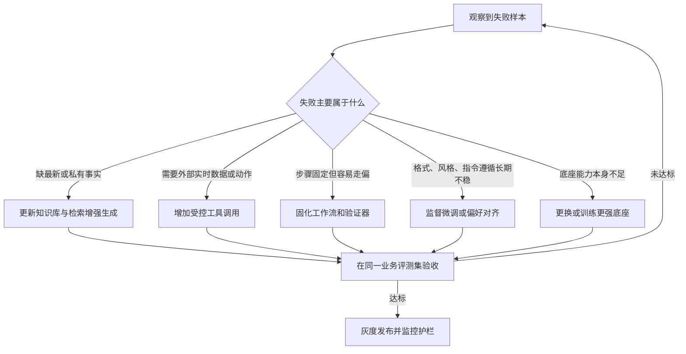

### 2.2 对齐算法谱系：不同算法对应不同"产品问题"

**一张对照表（面试可以直接画）**

| 算法 | 数据形态 | 是否需要独立 RM | 擅长解决 | PM 视角的判断 |
|---|---|---|---|---|
| SFT | 指令-回答示范对 | 否 | 教会格式、指令跟随 | 最便宜的第一步 |
| RLHF(PPO) | 人类偏好排序 + RM + PPO + KL | 是 | 整体偏好、安全性、有用性 | 成本高，周期长 |
| DPO | chosen/rejected 偏好对 | 否 | 直接提高优选回答概率 | 性价比最高的偏好手段 |
| ORPO | SFT 数据 + 偏好对 | 否 | 把监督与偏好约束合并一步 | 想省一轮训练时用 |
| KTO | 单条好/坏二元标签 | 否 | 不需要严格成对偏好 | 标注难成对时的备选 |
| GRPO | 同问题多答案的组内相对奖励 | 通常无需 critic | 可验证推理（数学/代码） | 有自动验证器时的首选 |
| RLVR | 规则/执行器/标准答案给奖励 | 否 | 有客观对错的任务 | 最"客观"的奖励来源 |
| RLAIF | AI 反馈替代人类反馈 | 否 | 降本、规模化 | 会继承评审模型偏见 |

**PM 的核心洞察：奖励信号从哪来，决定了产品能优化什么。**

这是我认为这一章最该记住的一句话。展开讲：
- **有客观验证器**（代码能跑通、数学有答案、SQL 能执行、文件 diff 可断言）→ 用 RLVR/GRPO，产品可以自动化迭代，**跑得飞快**。
- **只有主观偏好**（文案好不好、语气对不对）→ 必须依赖人类或人工智能评审，成本高、易漂移，**这就是为什么要建立标注规范并持续检查标注者一致性**。一致性是否足够，要结合样本量、标签难度和业务风险判断，不能只套一个固定阈值。
- **有业务结果**（这个回答是否促成了转化、是否减少了转人工）→ 这通常是最好的奖励信号，但延迟高、噪声大，适合作为**离线回流**而非在线奖励。

**核心指标**

| 指标 | 口径 | 用途 |
|---|---|---|
| 偏好数据一致性（Kappa） | 衡量多人标注超出随机一致的程度 | 数据质量诊断；结合标签分布和分歧样本解释 |
| 对齐前后 eval delta | 同一 golden set 上的通过率变化 | 判断值不值 |
| 拒绝率 / 过度拒答率 | 模型拒答占比 | 安全对齐的副作用监控 |
| 有用性-无害性平衡点 | 两个维度上的联合分布 | 对齐 tuning 的核心矛盾 |
| 风格一致性得分 | rubric 评分的方差 | 品牌一致性 |

**权衡与坑**
- 安全对齐过度会变成"啥都拒答"，这是产品体验的巨大杀手。**拒答率必须单独做成一个监控指标**，不要只看安全通过率。
- 对齐会引入"讨好倾向"（sycophancy）：模型倾向于同意用户而不是纠正用户。在高风险问答产品里，这是必须专门测试的一项。
- 偏好数据里如果混入了"长 = 好"的隐含偏好，模型会变得啰嗦。**标注规范里要明确"简洁"是独立评分维度**。

### 2.3 Reward Model：PM 才是奖励信号的源头

**原理一句话**：RM 把"提示 + 回答"映射成一个分数，数据可来自人类排序、规则、AI 评审、专家评分、用户反馈、可验证执行结果。

**产品现象**：**你定义什么是"好"，模型就变成什么**。很多团队抱怨"模型不听话"，本质是没人定义过"好"。

**PM 的可执行动作**
1. **写"好答案"的 rubric，而不是写"更好的提示词"**。rubric 至少拆成：相关性、完整性、事实正确性、指令遵循、格式、语气、来源忠实度。**不要压成一个总分**——压成一个分数你就不知道该改什么。
2. **把 rubric 变成标注规范**：写清正反例，让标注员独立判断，分歧走复审/仲裁，一致性抽样抽检，剔除低质/重复/泄露样本。
3. **偏好数据二选一并说明维度**：不要只让标注员"A 比 B 好"，要问"A 比 B 好在哪（准确/简洁/有用/安全）"。
4. **把线上行为信号接进来**：重生成率、编辑距离、采纳率、点踩、转人工，这些都是免费的偏好信号，但**要做去偏**（不点踩 ≠ 满意）。

**核心指标**：标注一致性系数、分歧样本率、坏例归因覆盖率、偏好数据入库量和线上信号进入训练集的转化率。阈值应通过试标、专家复核和错误成本共同设定。

**权衡**：AI 评审（RLAIF / LLM-as-a-judge）降本但会继承评审模型的偏见（偏好长答案、偏好自己风格）。**必须先用人类标注校准 judge，再规模化，且持续抽样人工复核**。

### 2.4 LoRA / PEFT / QLoRA：多租户定制的经济学

**原理一句话**：低秩适配（LoRA）冻结原权重 W，只学习一个低秩增量 ΔW = B×A。以 d=k=4096、r=8 为例，全参数约 1678 万参数，A+B 只需约 6.5 万——**约 0.4%**。A 小随机初始化、B 从零开始，保证初始 ΔW≈0；训练完可合并回 W。[^lora]

**产品现象**：这让"每个客户一个专属模型"从不可能变成可能。

**核心指标**

| 指标 | 口径 |
|---|---|
| 单租户训练成本/时长 | 一个客户定制的资源开销 |
| 定制前后 eval delta | 是否真的变好了 |
| 插件热插拔成功率 | 切换 LoRA 不重启、不串租户 |
| 多租户隔离正确率 | A 租户的请求不会用到 B 的适配器 |

**优化杠杆**
1. **把 LoRA 当成"SKU"来设计产品**：基础版（通用）、行业版（行业 LoRA）、企业版（客户私有 LoRA）。这是很漂亮的商业化分层。
2. **可插拔是卖点**：同一个基座 + 不同 LoRA = 多套能力，显存与运维成本远低于部署多个全量模型。
3. **QLoRA 解决的是资源问题，不保证效果提升**——这句话要说清楚，否则会被认为是话术。
4. **先做消融实验再决定叠加**：SFT 打底 → DPO 调偏好 → GRPO/RLVR 强化，每一层都要单独测增益。

**权衡**：LoRA 容量有限，跨领域的大幅度能力改造还是得全参数；适配器多了以后版本管理会成为新的运维负担（"哪个客户在用哪个适配器 + 哪个基座版本"必须台账化）。

### 2.5 模型蒸馏：大小模型配合的成本结构

**原理一句话**：学生模型学教师的输出/分布/轨迹。

**产品现象**：这是"用前沿模型生成 1000 条金标准回答 → 微调小模型 → 十分之一推理成本拿到接近前沿的效果"这条路径的技术基础。

**核心指标**：蒸馏后质量保持率（学生/教师在 golden set 上的得分比）、推理成本下降倍数、延迟改善、蒸馏数据许可合规性。

**优化杠杆**
1. **先识别出"高频且模式固定"的任务**：分类、抽取、路由、格式化输出——这些最适合蒸馏。
2. **分层部署**：难任务走教师，简单任务走学生，用路由分流。
3. **合规前置**：蒸馏涉及服务条款、授权与商业秘密，法务意见要在立项前拿。

**权衡**：学生模型的能力天花板受限于教师；教师换了要重新蒸馏；**"国内都在蒸馏国外"这种说法既不准确也不合规友好，面试中不要说**。

### 2.6 Loss / 优化器 / 训练稳定性：项目排期的风险项

**原理一句话**：因果语言模型常用交叉熵 loss；AdamW 是 Transformer 常用优化器；稳定技巧包括 warmup、decay、梯度裁剪、混合精度（BF16 动态范围更大，通常更稳）。

**产品现象**：这部分 PM 不需要推公式，但需要把它翻译成**排期风险**。

**核心指标**：训练吞吐（tokens/s）、单轮训练时长与成本、loss 曲线健康度（是否发散/平台化）、中断恢复时间、Checkpoint 回归通过率。

**PM 的可执行动作**
1. **把训练当成有风险的项目管**：设定"loss 不降就停"的检查点，避免烧了三周才发现配方有问题。
2. **要求中间产物的评测节点**：不要等训练完再评，每 N 步存 checkpoint 并跑小 eval。
3. **混合精度选 BF16 而非 FP16**（除非有明确理由），稳定性更好——这是可以直接给团队的工程建议。

**权衡**：稳定技巧（更小学习率、更强裁剪）会降低收敛速度。**排期上要为"重跑"留 buffer**，这是 AI 项目最常被低估的时间。

### 2.7 多卡并行与显存优化：为什么会"加卡不加速"

**原理一句话**：DP/DDP 分样本、TP 拆层内大矩阵、PP 把不同层放不同卡、ZeRO/FSDP 分片参数梯度优化器状态、梯度检查点用计算换显存。

**产品现象**：PM 会遇到"我们加了 8 张卡，为什么训练没快 8 倍"。

**核心指标**：扩展效率（实际加速比 ÷ 卡数）、通信时间占比、峰值显存、单卡吞吐、故障率与恢复时长。

**PM 视角**
- **多卡不线性加速是常态**，通信与同步会吃掉收益。排期时不要按线性外推。
- **梯度检查点**通过重新计算部分激活来节省显存，代价是增加计算时间；具体幅度随模型、层选择和实现而变。这是典型的“算力换容量”决策。
- 对 PM 而言，这一节真正的价值是：**训练成本可预测性**。要能回答"这次实验烧多少钱、多久出结果"。

### 2.8 Scaling Law 与评测基准：为什么不能迷信榜单

**原理一句话**：性能随参数量、数据量、算力平滑提升；可用小规模实验拟合曲线再外推。评测流程：选基准 → 构造并清洗题目集 → 用 lm-eval-harness 跑分 → 关注能力边界而非单点分数。

**核心指标**：业务自建评测集得分（最重要）、公开基准得分（次要）、分数方差（多次运行的稳定性）、版本间 delta。

**必须知道的坑**
- MMLU（知识）、HumanEval/MBPP（代码）、SWE-bench（真实工程修复）、ARC-AGI（抽象推理）、GPQA（研究生级科学）各有侧重，**没有一个是"综合智能"**。
- **分数受版本、提示、采样、工具、数据污染影响**，脱离测试设置横向比较是无效的。
- **公开榜单不能替代业务评测**。第三方排行榜是参考，不等于你的用户是否满意。
- 未公开参数量时，不要用估算冒充官方数字。

**面试话术**
> "我看榜单只做两件事：一是初筛候选模型，二是看趋势。真正决定选型的是我自己的 golden set 得分，以及单位任务成本。而且榜单分数有个很容易被忽略的问题——它通常是单次或少数几次运行的结果，而生产环境的用户体验取决于方差。所以我要求每个候选模型至少跑多次，看均值和最差情况，不看单次最好成绩。"

---

## 🤖 第 3 章　模块三 · Agent 体系 × 产品延伸

> 这是整份文档最重要的一章之一。智能体把模型从“生成内容”推进到“改变外部状态”，因此也是产品设计、评测和安全面试中的高频主题。

### 3.1 Agent 五件套：责任边界决定产品分工

**定义**：Agent = LLM（大脑）+ Harness（执行运行时）+ MCP（工具协议）+ Skill（技能 SOP）+ Memory（记忆）

**团队类比（建议在面试时用它解释）**

| 组件 | 类比 | 职责 | 不负责 |
|---|---|---|---|
| LLM | 首席架构师 | 决定"下一步做什么" | 不负责执行、不保证正确 |
| Harness | 项目经理 | 保存状态、控制循环、处理错误与权限、并发与终止 | 不做创造性决策 |
| MCP | USB-C 接口 | 标准化连接工具与数据源 | 不替模型思考 |
| Skill | 作业指导书/SOP | 约束"这件事该怎么做" | 不跨平台通用 |
| Memory | 档案柜 | 跨任务持久化用户偏好与事实 | 不等于上下文 |
| Context | 办公桌面 | 本次推理真正喂进去的内容 | 用完即弃 |
| Tool | 一次具体动作 | 搜索、读文件、跑代码 | — |

**产品化的关键**：**模型负责生成决策候选，Harness 负责控制循环，工具负责改变外部世界，验证器负责确认结果**。这条边界一旦模糊，产品的可靠性就无从谈起。

**核心指标**：见 9.3 的六层评测体系。此处先给两个最上层的：
- **端到端任务成功率**（独立验证过的完整完成，不是"产出了东西"）
- **自主完成率 / 人工接管率**（按任务类型细分）

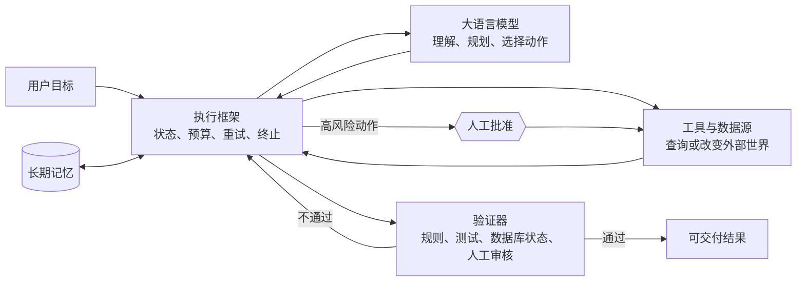

### 3.2 Harness：模型决定上限，Harness 决定下限

**原理一句话**：Harness 负责任务拆解、状态跟踪、错误重试、子 Agent 调度、把 LLM 的结构化指令翻译成工具调用。它是**代码级的调度运行时，不是配置文件**。

**产品现象**：可以用下面这组比喻记住分工——

> 让人惊艳的是模型；让业务赚钱的是 Harness；让团队睡得着觉的，还是 Harness。

同模型下，Harness 优化能带来可观的成功率跃迁。**模型是底座（必要条件），Harness 是产品（充分条件）**。

**PM 必须盯的六个"生产级痛点"与对应指标**

| 痛点 | 现象 | Harness 解法 | 对应指标 |
|---|---|---|---|
| 结果玄学难复现 | 同输入不同结果 | 模板化输入、固定工具集、固定验收脚本 | 多次运行一致性、P50/P95 步骤数 |
| 失败不可定位 | 不知是模型/工具/权限/上下文问题 | 结构化日志 + 分阶段埋点（输入→规划→执行→验证→发布） | 归因覆盖率、MTTD（发现时长） |
| 成本黑箱 | token/延迟/接管都在涨但说不清 | 模型路由、上下文剪枝、失败早停、缓存 | 单任务成本、token/任务 P95 |
| 安全合规焦虑 | 接了文件系统/代码执行/外发后风险倍增 | 最小权限、敏感动作护栏、全链路审计、可回滚 | 越权率、审计覆盖率 |
| 知识沉淀断层 | 错误被处理但没被系统记住 | 失败样本 → 规则库 → 评测集（失败可编译） | 新增错误类型数、失败→规则转化率 |
| 协作不可规模化 | 离了某个高手流程就崩 | 把个人技巧升级为组织协议 | 评测覆盖率、SOP 数量 |

**核心指标体系（Agent 产品的"看板四视图"）**

1. **周报视图（给老板）**：任务完成率 + 自主完成率 + 人工接管率（周环比），外加单任务成本。四个数，讲清产品是在变好还是变坏。
2. **失败分析视图（给 PM）**：失败任务按类型分布——卡死循环 / 工具报错 / 工具选错 / 置信度触底 / 用户标记。**每个 sprint 只修最大的那个桶**。
3. **轨迹效率视图（给工程）**：完成任务所需步数的 P50/P95/P99、任务时长直方图、按步骤类型的延迟。这能暴露循环与离群点。
4. **人工触点地图（给 UX）**：用户在流程哪一步介入？**如果 8 步流程里用户总在第 6 步介入，说明第 5 步有 bug**。

**五个最常见的度量错误（面试说出来非常加分）**
1. **未定义成功就统计完成率**：把"产出了东西"算成完成，会掩盖质量失败。
2. **把低接管率当成验证**：接管率下降可能意味着用户更信任，也可能意味着用户已经懒得纠错、"够用就行"。**必须配对输出质量审计**。
3. **只测 happy path**：用合成的理想用例测出来的分数和真实流量完全是两回事。**评测集要从真实失败里长出来**。
4. **没有人类专家基线**：不知道熟练人工做同一件事的时间、步数、错误率，就无法判断 Agent 是在提效还是在增负。**先建基线，再上 Agent**。
5. **跨任务类型聚合**：20 种任务的平均 70% 完成率，可能藏着简单任务 95%、复杂任务 20%。**从第一天就按任务类型细分**。

### 3.3 MCP：生态位与平台战略

**原理一句话**：MCP 标准化"模型 ↔ 工具/数据源"的接口，让模型即插即用调用文件、数据库、API、代码沙盒。

**产品现象**：如果人工智能功能需要连接外部工具与数据源，模型上下文协议提供了一种统一的能力发现与调用方式。是否采用它，仍要看现有技术栈、供应商支持、权限模型与安全审计能力，而不能只看生态热度。[^mcp]

**PM 的战略判断**

| 问题 | 判断框架 |
|---|---|
| 要不要支持 MCP？ | 如果产品需要连接第三方数据源/工具，支持 MCP 等于**让别人来帮你做集成** |
| 自己做 Server 还是等别人做？ | 高频刚需、有数据壁垒的自建；长尾的靠生态 |
| 开放还是封闭？ | 开放换取生态覆盖，代价是质量参差与安全面扩大 |

**核心指标**：可用工具数 vs **实际被调用的工具数**（后者才是真信号）、工具调用成功率、参数正确率、平均调用时长、单个 Server 的复用率与维护活跃度。

**关键判断（送分点）**：**SkillHub / 插件市场的数量不等于质量**。要看成功率、维护频率、权限声明清晰度、复用率。这句话在面试里可以替代"我们有很多插件"这种无信息量的表述。

**权衡**：接入的工具越多，上下文里的工具定义越占词元，名称和参数相近时也更容易干扰模型选择。**工具同样需要上下文工程**：按任务动态加载相关工具，描述清楚适用边界，并对高风险工具设置独立授权，不要把全部工具无差别塞入每次请求。

### 3.4 ReAct 循环：步数就是成本，也是体验

**原理一句话**：推理与行动协同（ReAct）把过程组织为“思考候选 → 动作 → 环境观察 → 下一步判断”的循环；动作交给执行框架运行，而不是让模型直接改变外部世界。[^react]

**产品现象**：用户感知到的是"AI 在一步一步做事"，也感知到"它好像卡住了"。

**核心指标**

| 指标 | 口径 | 说明 |
|---|---|---|
| 完成任务步数 | P50 / P95 / P99 | P99 暴露死循环 |
| 步数预算超限率 | 触及最大步数的任务占比 | 兜底触发频率 |
| 重复动作检测命中率 | 相同动作重复 N 次的检测率 | 死锁检测 |
| 单步延迟分布 | 按步骤类型（思考/检索/工具/验证） | 归因用 |
| 恢复率 | 工具失败后成功恢复的任务占比 | 可靠性的核心 |

**优化杠杆**
1. **设最大步数 + 总 token 预算 + 超时**，三重兜底。
2. **重复动作检测**：同一动作连续/高频重复即判定死锁，触发"换策略 / 请求人类 / 终止"三选一。
3. **幂等设计**：重试不能重复扣款、重复发信、重复删除。对有副作用的工具这是硬要求。
4. **给用户看进度，不要只转圈**：Plan Display（先说打算）+ Progress Indicator（现在第几步）+ Audit Trail（做过了什么），这三件套能显著提升信任。

**权衡**：步数上限设小了会误杀复杂任务；设大了成本失控且用户体验差。**建议做法**：按任务类型分别设上限，并对"接近上限"的任务做告警与人工介入。

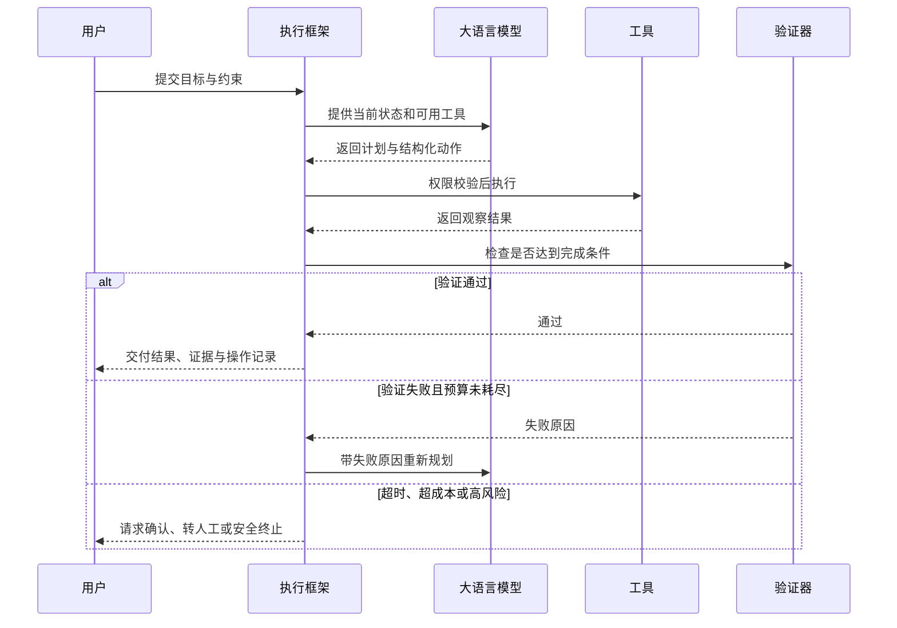

### 3.5 RAG：重头戏，指标最全的一节

检索增强生成（Retrieval-Augmented Generation）把外部检索到的证据与用户问题一起交给生成模型，让知识更新和来源追溯不必全部依赖模型参数。它降低无依据生成的风险，但不会自动保证检索正确或答案忠实。[^rag]

#### 3.5.1 为什么 RAG 是"减幻觉"而不是"免幻觉"

幻觉要分三段看，三段对应完全不同的修法：

| 段 | 失败形态 | 修法 |
|---|---|---|
| 检索段 | 该召的没召回（检索失败） | 混合检索、rerank、查询改写、chunk 策略 |
| 上下文段 | 召回了但被淹没/被截断/位置不利 | 压缩、重排、摆放规则、token 预算 |
| 生成段 | 上下文没问题但模型还是编 | 严格 groundedness 提示、拒答训练、引用校验 |

**绝大多数人以为幻觉是第三段，实际上大部分问题出在第一段。**

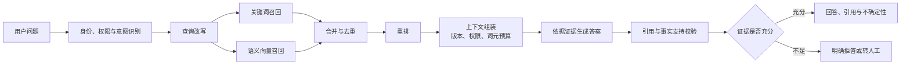

#### 3.5.2 指标：检索与生成必须分开测

**检索侧**

| 指标 | 回答的问题 | 示例起点，不是通用标准 |
|---|---|---|
| Recall@K | 需要的文档在 Top-K 里吗 | Recall@10 ≥ 0.8 |
| nDCG@K | 更相关的文档排得更前吗 | nDCG@10 ≥ 0.8 |
| MRR | 第一个相关结果出现得多快 | ≥ 0.7 |
| Precision@K / 上下文精确率 | 送进模型的东西有多少是有用的 | — |
| 检索延迟 P95 | 检索是否在 SLA 内 | 按端点定 |
| 单次查询成本 | 向量库读单元 + embedding 成本 | 按工作流定预算 |

> 为什么 Recall 是 RAG 的第一指标：**生成器无法从它没看到的证据里给出答案**。检索错了，后面全错，而且**静默失败**——模型依然会输出一段流畅的错误答案。

> **阈值纪律**：表中的数字只能作为搭建第一版评测时的示例起点。正式门槛应由任务失败成本、人类基线、可用数据量和线上实验共同决定；高风险领域通常更重视召回、忠实度和正确拒答，开放式创作则可能更重视有用性与多样性。

**生成侧**

| 指标 | 回答的问题 |
|---|---|
| 忠实度 / groundedness | 每个声明都被检索到的上下文支持吗？（有支持/矛盾/信息不足三态） |
| 答案正确性 | 与参考答案在实质上一致吗 |
| 引用正确率 | 引用指向的段落真的支持该声明吗 |
| 恰当拒答率 | 文档里没有答案时，系统会不会说"不知道" |
| 有用性/采纳率 | 用户是否真的用了这个答案 |

**忠实度的计算方式**：把答案拆成原子声明，逐条判定 supported / contradicted / not_found：

```
Groundedness = 有支持的声明数 ÷ 事实性声明总数
```

**关键技巧**：要求 judge 引用它据以判定的原文，然后做字符串匹配验证该引用确实存在于源文档中。因为 judge 经常"标记支持但编造证据"，一个简单的字符串匹配就能廉价地抓出来。

#### 3.5.3 联合读数的诊断表（这张表建议背下来）

| 检索 | 生成 | 诊断 | 该修哪里 |
|---|---|---|---|
| Recall 低 | 忠实度高 | 模型在烂上下文里表现良好 | **修检索** |
| Recall 高 | 忠实度低 | 正确材料到了，模型跑偏 | 修提示/模型/上下文格式 |
| 答案正确 | 忠实度低 | ⚠️ 模型在用训练数据答题，一旦你的文档与常识冲突就会翻车 | 修 groundedness 约束 |
| Recall 高 | 拒答率高 | 阈值太严或提示过于保守 | 平衡拒答与有用性 |

#### 3.5.4 优化杠杆（按 ROI 排序）

1. **建立黄金评测集**：从一个小而有代表性的集合起步，再依据置信区间、失败类型覆盖和线上流量逐步扩展；样本数不是越大越好，关键是代表性与稳定性。每条包含：真实用户问法的问题、包含答案的段落标识、参考答案或必须包含的关键事实、意图、难度、风险标签，**以及“文档里没有答案”的问题**。
2. **混合检索（BM25 + dense + fusion）**：纯向量会漏掉精确 ID、文件名、术语。
3. **Rerank**：广召回 50~100，cross-encoder 重排到 5~10。
4. **查询改写 / 扩展 / 同义词词典**：解决用户用词与文档用词不一致。
5. **切块调优**：基于段落、标题和语义边界生成多组候选，用召回率与忠实度选择；给每个片段记录来源、章节、版本与权限元数据。
6. **父子 / 句子窗口检索**：解决跨 chunk 的答案边界丢失。
7. **权限感知过滤（查询时）**：不要事后过滤，否则存在泄漏路径。
8. **索引版本化与漂移监控**：换 embedding 模型要重建索引，先在影子管道重嵌入再切流；每月对稳定文档样本重嵌入比对近邻集合。
9. **CI 门禁**：把 Recall@K / nDCG@K 做成 CI 检查，任何改动都要过。
10. **失败兜底**：检索为空时**明确返回"没有找到相关资料"**，而不是让模型从空上下文里自由发挥。

#### 3.5.5 前置 RAG vs 工具化 RAG

| | 前置 RAG（静态） | 工具化 RAG（Agent 内） |
|---|---|---|
| 时机 | 首次调用 LLM 前检索一次 | 注册为工具，在 ReAct 中按需检索 |
| 优点 | 简单、可控、延迟可预测 | 能换关键词、能多跳、支持 self-judge |
| 缺点 | 无法主动调整检索策略 | 步骤多、成本高、延迟不可控 |
| 适用 | 单轮问答、知识库搜索 | 长任务、研究型、需要迭代检索的 Agent |

**PM 决策**：**先用前置 RAG 跑通，再在需要多跳/自检的场景上升级为工具化**。不要一上来就做全动态。

#### 3.5.6 权衡：groundedness vs helpfulness

这是 RAG 产品最核心的一个平衡：
- 模型只复述检索到的文本 → 忠实度高但用户觉得"没帮我总结"，满意度下降。
- 模型激进综合 → 有用性上升但无支持声明增加。

**建议做法**：**按查询的风险与模糊度分层**。高风险领域（医疗、金融、法务、售后政策）设严格的忠实度阈值；低风险的探索性场景允许更多综合。这就是"分层治理"在 RAG 上的具体落地。

### 3.6 Skill / Plugin / Tool / MCP Server：平台产品的对象模型

**边界（以平台定义为准，但差异如下）**

| 概念 | 本质 | 是否含代码 | 是否跨平台 |
|---|---|---|---|
| Skill | 可复用的任务方法/提示/检查清单/模板/脚本 | 不必然 | 不保证 |
| Plugin | 可安装扩展包（含技能说明、工具、连接器、UI、权限声明） | 是 | 平台绑定 |
| Tool | 一次具体调用 | 是 | — |
| MCP Server | 通过 MCP 暴露工具/资源/提示模板的服务端 | 是 | 协议级通用 |

**产品指标**：Skill 复用率、Skill 成功率、Plugin 安装→活跃转化率、权限声明清晰度评分、维护 SLA（多久没更新）。

**PM 判断**：**Skill 是"知识资产"，Plugin 是"分发单位"**。两者要分开运营：Skill 的质量靠评测集与版本管理，Plugin 的质量靠权限治理与维护活跃度。

### 3.7 编排框架：LangChain 不是必需品

**原理一句话**：LangChain/LangGraph 做编排，LangGraph 偏向带状态、分支、循环、断点恢复的图运行时；AutoGen 偏多 Agent 对话。**没有它们也能工作**——核心是自写循环：调 LLM → 解析输出 → 调工具 → 回填 → 再调 LLM。

**PM 判断框架**

| 阶段 | 建议 |
|---|---|
| 验证期（0→1） | 直接手写循环，最快、最少依赖 |
| 需要断点恢复/人工介入/长时任务 | 上 LangGraph 类带状态的图运行时 |
| 需要多角色协作 | 再考虑 AutoGen 类 |
| 上了规模、需要可观测 | 配套 Langfuse / LangSmith / Braintrust 做 trace 级观测 |

**轻量替代方案**：先用结构化日志、数据仓库和开源看板完成关键链路追踪，再依据排障效率和团队规模决定是否采购完整可观测平台。轻量方案仍有存储、维护与权限治理成本，不能视为零成本。

**其他范式速记**：Plan-and-Solve（先计划后执行）、Reflexion（失败后反思并加入上下文）、Toolformer 思路（学习何时插工具调用）、Multi-Agent（见 10.4）。

### 3.8 Memory vs Context：记忆产品化的三个问题

**边界**：Memory 是跨任务持久化的信息；Context 是本次推理真正喂给模型的窗口。**先记忆检索再组上下文**，是为了把最相关的历史塞进有限窗口、减少噪声与幻觉。**KV Cache 既不是 Memory 也不是 RAG 数据库**（见 3.9）。

**产品现象**：用户会误以为"AI 记得我们上次聊的"。这是产品承诺最容易翻车的地方。

**记忆产品化的三个必答题**

1. **写什么？** 定义可写入的字段白名单（用户偏好、项目事实、常用格式…）。**不要把整段对话默认写入**。
2. **谁能看？** 记忆要有归属与权限；多租户场景下记忆必须隔离。
3. **能删吗？** 用户必须能查看、编辑、删除自己的记忆，且要有保留期。

**核心指标**：记忆召回精确率、记忆导致的错误率（错误记忆被用上的比例）、记忆查看/删除功能使用率、记忆注入后的 token 增量。

**权衡**：记忆越多个性化越强，但上下文膨胀、隐私风险、以及"错误记忆被反复强化"的问题也会同步上升。**建议：默认关闭写入，只在用户显式确认或高置信度时写入**。

### 3.9 KV Cache 与 Prompt Cache：成本与延迟的胜负手

> 这是面试中出现频率极高、且最容易答混的一组概念。答对了非常加分。

#### 3.9.1 三者必须分开

| 类型 | 作用域 | 缓存什么 | 谁受益 |
|---|---|---|---|
| **KV Cache** | 同一次生成请求内部（跨 decode 步） | 每层历史 token 的 K/V 张量 | 降低每个输出 token 的重复计算 |
| **Prompt/Prefix Cache** | 跨请求（API 产品层） | 固定前缀预填充后的中间状态 | 命中即跳过部分 prefill，降 TTFT 与成本 |
| **应用缓存** | 业务层 | 完整响应 / 检索结果 / embedding | 直接省掉整次调用 |

**一句话区分**：KV Cache 是"这一次生成过程中别重复算"；Prompt Cache 是"上一个用户算过的固定前缀别再算一遍"；应用缓存是"这个答案我已经给过了"。

#### 3.9.2 为什么输出 token 更贵

自回归串行执行：每生成一个新 token 都要走完所有层、并读取不断增长的 KV Cache。**不是"每次重读历史文字"**——这是常见误解。

#### 3.9.3 指标与优化

| 指标 | 说明 |
|---|---|
| TTFT（首 token 延迟） | 受排队、网络、输入长度、Prefill、缓存命中影响 |
| ITL / TPOT（token 间隔 / 每输出 token 时间） | 决定"输出刷得快不快" |
| 缓存命中率 | prefix cache 命中比例（分精确缓存与语义缓存） |
| 缓存驱逐率 | 命中率的天敌，高驱逐会让收益消失且方差变大 |
| token 长度分布 P50/P95/P99 | 只报均值会掩盖长尾 |

**优化杠杆（PM 可推动的产品侧改动，成本低、收益高）**
1. **固定内容在前，变化内容在后**：工具定义 → 系统提示 → 参考文档 → 对话历史 → 当前问题。顺序一乱，prefix cache 全废。
2. **不要在提示开头放时间戳 / request_id / 用户名**：这是最常见的毁掉缓存命中的错误。
3. **系统提示版本化**：改一个字，缓存全失效。所以要版本化 + 灰度。
4. **缓存生命周期通常是分钟级**：低流量服务会在两次请求之间过期，命中率天然低——这时候别指望缓存，改走其他优化。
5. **语义缓存**：对高频重复查询可能显著减少推理调用，但必须用误命中实验校准相似度阈值，设置有效期与新鲜度抽样审计；高风险、强个性化或快速变化的答案默认不复用。

**真实收益量级（可用于面试估算）**：
- 一个 8000 token 系统提示 + 200 token 问题的场景，若缓存读按 10% 计价，命中的输入成本从 8200 token 降到约 1000 token，**降幅约 88%**。
- 智能体流水线可能反复携带系统提示、工具定义和稳定知识，前缀缓存因此值得优先评估；实际节省比例和首字延迟改善取决于前缀长度、命中率、供应商计费和服务实现。

**权衡**：缓存引入新的失败模式——**陈旧/错配的答案**。从延迟指标上完全看不出来，必须配抽样新鲜度审计和质量 judge。

### 3.10 上下文工程：AI PM 的新手艺

**定义**：Prompt Engineering 关注单条提示；Context Engineering 关注**此刻模型应该看哪些信息、什么顺序、什么格式、何时更新**。Anthropic 的定义是"在推理过程中策划并维护最优 token 集合的策略"。

**上下文窗口的六类组成**（建议照这个清单做预算）

1. 系统规则 / 角色边界
2. 当前任务与状态
3. 长期记忆检索结果
4. RAG 证据与来源
5. 工具定义与 Schema
6. 最近 Observation / 历史摘要 / 示例 / 输出格式 / 停止条件

**推荐拼接顺序**：系统规则 → 任务规则与工具 → 精选记忆和 RAG 证据 → 必要历史 → 最新 Observation → 当前请求。

**核心指标**

| 指标 | 口径 |
|---|---|
| 任务成功率 | 端到端、按任务类型细分 |
| 证据利用率 | 提供的证据中被实际引用的比例 |
| 上下文相关率 | 进入上下文的片段中相关的比例 |
| 提示注入抵抗率 | 红队注入用例中被成功抵御的比例 |
| token 成本 / 任务 | 输入+输出，分 P50/P95 |
| 延迟（TTFT / E2E） | P95 为准 |

**四个失败模式（背下来，面试可举）**

| 模式 | 表现 | 解法 |
|---|---|---|
| **上下文投毒** | 早期错误/幻觉进入上下文并被后续反复引用 | 阶段性清空、验证后写入、来源标记 |
| **上下文分心** | 历史/工具输出太多，模型复述过去而不规划未来 | 摘要压缩、截断、工具输出裁剪 |
| **上下文混淆** | 无关内容/多余工具干扰选择 | 工具动态加载、证据重排 |
| **上下文冲突** | 不同来源信息互相矛盾，模型无法判断权威 | 明确优先级、版本标记、冲突检测 |

**三个典型的"坏上下文工程"案例（非常适合当面试素材）**

1. **退化型 Agent**：测试时很好，上线后长对话开始胡说。原因：到第 15 轮，原始历史占满窗口，早已解决的老问题还躺在上下文里，模型试图调和它们。**解法**：滚动压缩——把已解决的线程摘要掉，模型只需要知道"现在在哪"，不需要完整回放。
2. **仍然幻觉的 RAG**：文档都在库里，模型还是编。原因几乎总是检索质量——拉错了 chunk，或者把相关段落埋在 5000 token 的无关文本中间。**解法**：语义切分、少而精的 chunk、最相关的放最后、检索质量与生成质量分开评。
3. **闹鬼的系统提示**：半年里每出现一个 edge case 就加一条规则，从没删过任何东西，最后 4000 token 里全是互相矛盾的指令。**解法**：像审代码一样审提示——每条规则有理由、矛盾项必须裁决。**400 token 无矛盾 > 4000 token 内部打架**。

**灰度纪律**：上下文改动尽量一次只改一个主要变量，因为变量会互相干扰。先在有代表性的离线评测集检查回归，再用足以控制风险且能获得有效样本的小流量观察生产指标，无异常再逐级扩大。

### 3.11 Tree of Thought / self-judge：验证器优先原则

**原理一句话**：CoT 沿单条路径；ToT 生成多候选分支并评估保留（成本更高）；self-judge 是模型或评审器按验收标准检查并重试，**但不保证正确**（生成者与评审者可能共享盲点）。

**核心原则**：**能用外部验证时，不应只靠模型自评。**

**可验证环境的优先级（从硬到软）**
1. 单元测试 / 编译器 / linter（最硬）
2. 数学验证器 / 规则引擎 / SQL 执行
3. 文件 diff / 数据库断言 / 网页状态断言
4. 业务断言（订单状态、金额一致性）
5. 多模型投票一致性（中等）
6. LLM-as-a-judge（最软，必须校准 + 抽样人工复核）

**核心指标**：验证器覆盖率（有多少任务能被自动判定）、self-judge 与人工判定一致率、重试成功率（重试后变好的比例）、重试成本占比。

**权衡**：ToT / 多候选显著提升质量但成本成倍上升。**建议只在"错误代价高、单次成本可接受"的任务上开**，并用路由控制。

### 3.12 Computer Use / 权限：信任设计是产品功能

**原理一句话**：靠截图/可访问性树观察，用点击、键入、滚动操作界面。**"能看到界面"不等于"自动拥有权限"**。

**产品指标**：不可逆动作确认率、越权尝试拦截率、沙箱逃逸检测率、动作审计覆盖率、用户撤销率、高风险动作的人工确认时长。

**设计要点**
- 登录、支付、发帖、删除、上传敏感文件 → **必须人类确认**
- 沙箱、域名白名单、最小权限、动作审计是四条关键防线
- **不要绕过验证码**；站点有权限制自动化

**典型事故模式**：攻击者把恶意指令藏在网页、邮件或上传文档中；智能体读取后误把外部数据当成高优先级指令，并调用拥有写权限的工具。如果下游系统不做独立授权和参数校验，模型的一次误判就会变成真实世界的改绑、外发、删除或付款事故。

**这个事故模式的三条产品结论**：
1. **不可逆操作 = 强制审批门 + 下游系统独立校验**（不要把信任委派给 LLM）
2. **自治度是分级的，不是二元的**（见 6.2）
3. **可撤销性本身就有价值**：用户知道自己能反悔，才敢点确认

---

## 🖥️ 第 4 章　模块四 · 算力与硬件 × 产品延伸

> PM 不需要会装机，但必须能把"能不能跑、跑多快、多少钱"翻译成产品可行性与定价。

### 4.1 算力 / 显存 / 带宽三大件

| 件 | 决定什么 | 产品映射 |
|---|---|---|
| **算力（TFLOPS）** | 单轮耗时、出字速度 | 用户体验（TPS） |
| **显存（VRAM）** | 能装下权重 + KV Cache + 激活 | **能否跑起来** + 并发上限（第一瓶颈） |
| **带宽**（显存带宽 + 互联带宽） | GPU 是否空等数据 | 算力利用率、成本效率 |

**产品判断**：显存是大模型的第一瓶颈。这解释了为什么"参数量只大一点点"会让成本跳一个台阶——**不只是算力问题，是能不能装下和能装多少并发的问题**。

**核心指标**：单并发显存占用、最大并发数、GPU 利用率、单 token 成本、批处理扩展效率。

**PM 的可执行动作**
1. **把"并发上限"当成产品容量参数**：容量规划、限流策略、排队提示都依赖它。
2. **理解显存构成**：权重 + 激活 + KV Cache。其中 **KV Cache 随并发和上下文长度线性增长**，是长上下文产品的隐形杀手。
3. **offload 到内存是测试手段，不是生产方案**：可行但 PCIe 慢，延迟高，并发下容易卡死。

### 4.2 训练成本 → 商业化定价的传导

**原理**：训练通常比推理占用更多显存，因为除权重外还要保存梯度、优化器状态和每步激活。模型越大、序列越长，训练资源需求越高。

**产品映射**：这决定了三件事——
1. **为什么基础模型只有少数公司做**：这是资本门槛，不是技术门槛。
2. **为什么 API 价格会持续下降但要谨慎承诺**：算力成本、利用率、竞争格局共同决定。
3. **为什么"我们自研大模型"对大多数公司是伪命题**。

**核心指标**：训练总成本、单次实验成本、GPU 利用率（自部署 vs API 的关键盈亏变量）、模型折旧周期。

**盈亏判断**：不要背固定显卡小时价格或利用率阈值。用目标地区的实时云价或采购价，加入闲置容量、运维、故障恢复、安全、机房、折旧和人员成本，再与应用程序编程接口的真实账单做同口径比较。负载稳定、规模足够、数据与延迟约束强时自建更可能成立；需求波动大、模型更换频繁时托管服务通常更灵活。

### 4.3 端侧 vs 云侧：一条产品决策链

| 维度 | 端侧 | 云侧 |
|---|---|---|
| 隐私 | 强（数据不出设备） | 弱（需信任供应商） |
| 离线 | 可用 | 不可用 |
| 延迟 | 首字节快、无网络抖动 | 取决于网络 |
| 能力 | 受内存/算力限制 | 最强模型 |
| 成本结构 | 一次性硬件，边际成本低 | 按调用计费 |
| 一致性 | 设备差异大 | 统一 |
| 更新 | 需推送模型 | 服务端即改 |

**决策框架（推荐答案）**：

```
先看两条硬约束：
  1. 数据能否出域？（合规/用户承诺）→ 不能出域则端侧或私有化
  2. 任务是否需要最强模型？（复杂推理、长文档）→ 需要则云侧
两条都不硬 → 混合：端侧处理高频简单任务 + 云侧兜底复杂任务
```

**统一内存 Mac vs 独显**：Mac 偏**容量与易用**（统一内存能装更大量化模型），RTX 偏**速度与生态**（绝对算力、显存带宽、CUDA 生态更优）。对产品而言，这意味着同一款端侧产品在两类设备上的能力边界不同，**要有能力清单降级文档**。

**核心指标**：端侧任务完成占比、云侧切换率、切换延迟、离线功能可用率、设备发热/耗电（移动端体验红线）。

### 4.4 CUDA 生态：供应链风险是产品风险

**原理**：CUDA 是"让软件指挥 GPU 干活"的平台，关键库包括 cuBLAS（矩阵乘）、cuDNN（深度网络原语）、NCCL（多卡/多机集合通信，分布式训练的"神经网络"）。

**产品映射**：生态锁定 = **供应链风险 = 需要写进产品风险登记册**。

**PM 动作**
1. **架构上保持可移植**：标准化 serving API、容器化引擎、可重跑的评测套件——**可移植性比最后 15% 的吞吐更值钱**。
2. **国产化替代要提前做 POC**，不要等政策或断供时才动。
3. **成本模型要跟着硬件周期走**（硬件 3~6 个月一代），合同与定价要有弹性条款。

### 4.5 Ollama 与本地推理：私有化交付的抓手

**原理**：Ollama 在本地跑开源 LLM，默认加载 GGUF，提供 `http://localhost:11434` API。

**产品映射**：私有化交付、离线演示、开发者体验、内网合规场景。

**核心指标**：部署成功率、首次启动时长、模型下载/更新带宽成本、版本一致性（客户端装的模型版本是否受控）、离线功能可用率。

**PM 提醒**：本地跑不等于合规。**遥测、日志上报、崩溃报告**在私有化场景里都要重新设计，写进隐私说明。

### 4.6 “能跑起来”不等于“能稳定服务”

通过把部分权重卸载到内存或磁盘，设备可能勉强生成结果；但生产服务还要同时满足并发、尾部延迟、长时间稳定、故障恢复、容量扩展与服务目标。因此硬件验证至少分为三档：

| 档位 | 完成标准 | 不能据此承诺什么 |
|---|---|---|
| 演示 | 单个样例能生成正确结果 | 不能承诺稳定延迟、连续运行或多用户 |
| 试用 | 目标设备上单用户连续完成主要任务 | 不能承诺高峰并发和服务级协议 |
| 生产 | 目标流量压测、长稳测试、故障恢复和容量告警全部达标 | 才能形成正式能力清单与服务承诺 |

**硬件选型四问**：模型与上下文能否完全装入目标内存；目标并发下第九十五和第九十九百分位延迟是多少；连续运行时是否出现内存泄漏、过热或驱动故障；需求翻倍时能否复制部署或自动切换云端。

**不同设备的产品语言**：独立显存设备通常更重视计算速度、显存带宽和软件生态；统一内存设备可能更容易装入较大模型，但峰值吞吐和框架兼容性需要单独验证。采购决策应从“验证想法、轻量微调、批量推理还是线上服务”出发，而不是从品牌出发。

**容量指标**：模型驻留内存、键值缓存水位、可承载并发、排队时长、内存溢出率、连续无故障运行时长、自动恢复时长和单位成功任务的硬件成本。

---

## 🌐 第 5 章　模块五 · 大模型生态 × 产品延伸

### 5.1 模型选型矩阵：不要选"最强"，选"达标且最便宜"

**选型框架（五步）**

1. **定任务类型**：生成 / 抽取 / 分类 / 推理 / 工具调用 / 多模态
2. **定质量下限**：在自建 golden set 上必须达到多少分（不是"越高越好"）
3. **定约束**：延迟预算、成本预算、数据出域要求、部署方式、合规
4. **跑对比评测**：**用你自己的用例，不是榜单**。固定系统提示、工具、温度、预算与运行次数
5. **定退出方案**：模型弃用/涨价时怎么切（多模型架构 + 抽象层）

**比较代际要看的六个维度（面试可直接复述）**
基座能力 / 工具能力（参数准确度、并行、失败修正）/ 长程可靠性（完成率、状态保持、恢复）/ 效率（TTFT、吞吐、价格、缓存）/ 安全与控制 / 评测证据（公开基准 + 业务回归集）

**核心指标**：单任务成本、单任务质量分、P95 延迟、路由准确率、切换回归通过率、供应商集中度。

**现实判断**：许多产品失败并不是底座模型能力不足，而是任务定义、数据、检索、工具、评测或交互链路没有做好。所以：
- 不要在模型选型上过度内耗，**选一个先上线，留好切换能力**
- **过早做 token 成本优化是错的**：先设计工作流，再估算用量与服务成本
- 工具集成、计算机操作、智能体评测与安全控制，往往比继续追逐单一榜单分数更影响真实交付

**候选模型分组（先分组，再逐个实测）**

| 候选类别 | 优先验证的问题 |
|---|---|
| 托管通用模型 | 业务质量、工具调用、服务稳定性、数据条款、价格波动与供应商锁定 |
| 开放权重模型 | 许可证、目标硬件吞吐、量化损失、运维与安全补丁成本 |
| 长上下文模型 | 随长度增长的准确率曲线、中间位置证据利用率、首字延迟与输入成本 |
| 多模态模型 | 图片、音频或视频输入的真实任务成功率，不只看演示样例 |
| 代码专用模型或智能体 | 仓库级任务成功率、测试通过、修改范围、执行安全和回滚能力 |
| 小模型或端侧模型 | 设备覆盖、包体、冷启动、耗电、发热、离线能力和云端兜底 |

> ⚠️ 时效提醒：模型名称、参数量、价格、上下文长度、许可证、能力都会变。**核验顺序：官方模型页/技术报告 → 官方 API 文档与价格页 → 官方仓库模型卡 → 可信第三方实测**。未公开参数量时不要用估算冒充官方数字。这个习惯本身就是面试加分项。

### 5.2 垂类 vs 通用：护城河在哪

**定义**：垂类 = 基座 + 私有知识库 + 交易 API + Agent（如美团"问小团"是酒旅垂类，不是通用模型）。

| | 通用模型 | 垂类模型 |
|---|---|---|
| 优势 | 泛化强、更新快、成本低 | 行业精准、可直连业务、可交付结果 |
| 劣势 | 缺行业深度、无私有数据 | 泛化弱、维护成本高、依赖基座 |

**产品判断**：**垂类的护城河不在模型，在数据与流程集成**。而数据与流程集成恰恰是 Agent/Harness 的活。所以对垂类 AI 产品来说，真正难的是：
- 私有数据的获取与权限治理
- 与业务系统（订单、库存、审批）的深度打通
- 行业流程的 SOP 沉淀（Skill）

### 5.3 开放权重改变四种成本

| 成本 | 封闭 API | 开放权重 |
|---|---|---|
| 调用成本 | 按次付费，被次数绑定 | 可自部署，边际成本可控 |
| 迁移成本 | 难改模型 | 可改、可换 |
| 数据治理成本 | 敏感数据出域 | 数据留本地 |
| 竞争成本 | 供应商垂直整合 | 芯片/云/应用/开发者围绕同一模型竞争 |

**为什么芯片/云/应用公司都支持开放权重**：模型越易得，对算力、部署、微调、安全、行业应用的需求越大，**价值向其他环节扩散**。这是一个很好的产业链洞察，面试中引用能体现商业理解。

**PM 决策**：开放权重不是“免费”。它把成本从按次付费转移到运维、人力、容量冗余和算力闲置。使用 4.2 节的同口径总拥有成本方法判断，而不是套固定利用率阈值。

### 5.4 产业链定位：你在哪一环

```
芯片企业（NVIDIA / AMD / 昇腾）→ 造算力（发动机）
     ↓
云厂商（阿里云 / 腾讯云 / 火山引擎）→ 租算力 + 提供模型 API（房东）
     ↓
第三方服务商（vLLM / LangChain 类）→ 把算力变成业务系统（装修队/家具商）
     ↓
应用方（如美团买火山 GPU，用编排框架做酒旅 Agent）
```

**PM 的自我定位**：你大概率在最后一环。这意味着你的核心能力不是"选哪个芯片"，而是**在给定算力预算下，把不确定的模型能力变成稳定的业务结果**。

### 5.5 商业化与定价

**为什么从免费走向付费**：推理算力、训练研发、内容审核、带宽都是持续成本；付费还能区分轻度/重度用户、保障高峰容量、验证专业价值。

**PM 必须能算的三笔账**
1. **单用户成本**：免费用户单次对话 1000 token × 单价 × 日调用次数 → 单用户日成本 → 乘以用户量
2. **盈亏平衡点**：AI 成本 vs 人工替代成本的拐点在哪
3. **分层策略**：免费额度怎么定、重度用户怎么收、高峰怎么限流

**诚实原则（面试加分）**
- "是否由集团补贴"：**需财报/披露/可靠报道确认，不能从"免费"直接推导**
- "是否已盈利"：**有付费功能 ≠ 整体盈利**。要区分订阅收入、API 收入、获客补贴、折旧、研发与算力成本；未披露就标注"无法从公开信息确定"

> 这种"知道什么不知道"的表达，是高级 PM 的标志性特征。

**核心指标**：单用户 AI 成本、AI 毛利率、AI 功能对留存/转化的增量、付费转化率、免费额度消耗分布、高峰限流触发率。

---

## 🧭 第 6 章　模块六 · AI 产品与交互工程 × 产品延伸

### 6.1 评测与标注：Eval-First 工作流（本章最重要）

#### 6.1.1 三层评测体系

| 层 | 回答的问题 | 典型指标 |
|---|---|---|
| **单轮/模型层** | 这个 prompt、这个模型版本效果好不好 | 准确率、幻觉率、格式正确率、拒答率、延迟 |
| **链路层** | 从输入到输出整条链路有没有断点 | 意图识别准确率、工具调用正确率、RAG 检索质量、任务成功率 |
| **业务层** | 用户是否因 AI 功能更愿意使用/付费 | CSAT/NPS、任务完成率、转化率、留存、复询率 |

**三层缺一不可。** 只做第一层的团队，上线后会发现用户根本不买账——因为链路断点、业务价值没被验证。**记住：模型效果好 ≠ 产品体验好 ≠ 业务价值高。**

不同公开评测对“幻觉”的任务、样本与判定口径差异很大，不能把某个公开百分比直接当作业务基线。**垂直场景必须用自己的用户问题、知识边界和风险等级建立评测集。**

#### 6.1.2 Golden Dataset：评测体系的基石

**构成与配比**

| 样本类型 | 特征 | 占比建议 |
|---|---|---|
| 正常路径样本 | 常见场景、结果清晰、代表主业务路径 | 应覆盖主要流量和高价值任务 |
| 边缘样本 | 信息不完整、有歧义、跨场景混合 | 按线上失败分布持续补充 |
| 对抗样本 | 领域外问题、越权请求、提示注入 | 按风险等级提高占比，不追求固定比例 |

**调整规则**：高风险场景（金融、医疗）提高对抗样本比例；知识问答类提高边缘样本比例。

**质量控制四要点**
1. **标准文档化**：每个场景写明正确输出标准，避免"凭感觉标注"
2. **一致性检验**：多人试标后计算一致性系数，查看分歧集中在哪些标签并迭代规范；是否可用要结合标签分布和失败成本
3. **版本化管理**：像代码一样版本化，每次迭代更新，保留历史版本用于回测
4. **季度审查**：清理失效用例、合并重复用例、补充新场景

**按任务类型拆分评测集**（不要用一个通用集覆盖所有场景）

| 任务类型 | 评测重点 | 例子 |
|---|---|---|
| 事实型 | 准确性、依据性、时效性 | "公司年假最多可休几天？" |
| 流程型 | 步骤完整性、逻辑正确性 | "新员工入职需完成哪些权限申请？" |
| 推理型 | 逻辑一致性、推理链正确性 | "A>B 且 B>C，则 A 与 C 的关系" |
| 创作型 | 可采纳率、风格一致性 | "写一封产品推广邮件" |

**规模建议**：先覆盖主要任务、关键边界与高风险失败，再用置信区间和重复运行判断样本量是否足够。无论起步规模是多少，评测集都必须持续从真实失败中增长，而不能长期停留在合成的理想用例。

#### 6.1.3 核心指标 + 护栏指标

| 产品形态 | 核心指标 | 辅助指标 | 护栏指标 |
|---|---|---|---|
| 写作/生成类 | 可采纳率、风格一致性 | 字数、编辑比例 | 安全违规率 |
| 问答/检索类 | 准确率、依据性 | 响应延迟 | **幻觉率** |
| Agent/任务类 | 任务成功率、端到端达成率 | 工具调用正确率 | 异常终止率 |
| 对话/客服类 | 问题解决率、CSAT | 会话轮次 | **转人工率** |

**护栏指标的价值**：防止"指标退化"——核心指标上涨但稳定性同步下降。比如幻觉率就是问答类产品的护栏，**无论如何优化都不能突破安全阈值**。

#### 6.1.4 Bad Case 驱动的四步闭环

```
收集 Collect  → 用户反馈入口 / 人工抽检 / 自动化异常检测 / 转人工记录
归因 Analyze  → 根因分析，标签标准化（见下）
修复 Fix      → Prompt / 知识库 / 模型版本 / 链路逻辑
验证 Validate → 在 golden set 上回归，确认新问题没引入、老问题没复发
```

**归因标签体系（三层）**

| 层 | 典型分类 |
|---|---|
| 技术层 | Prompt 缺陷 / 模型能力不足 / 知识库缺失 / 检索失败 / 工具调用错误 |
| 体验层 | 响应太慢 / 输出太长 / 格式混乱 / 语气不当 / 无法纠错 |
| 业务层 | 需求理解偏差 / 场景覆盖不足 / 权限判断错误 / 合规风险 |

**关键态度**：**Bad Case 不是负担，是产品进化的燃料。** 谁建立了系统化的收集-归因-修复机制，谁就掌握了 AI 产品的迭代节奏。

#### 6.1.5 质量度量必须"自动 + 人工"混用

自动化指标告诉你"哪里可能有问题"，人工抽检告诉你"问题到底是什么"。

**稳定做法**：线上指标 → 抽样人工复核 → 标注 bad case → 每周趋势复盘。

**在线 vs 离线**：
- 离线评测可重复比较，是回归的基石
- 在线评测看真实完成率/重试/点踩/接管/留存
- **在线不能替代离线回归**；公开榜单不能替代业务评测

### 6.2 Human-in-the-Loop：自治光谱与信任设计

#### 6.2.1 自治四级模型

| 级别 | 含义 | 典型动作 |
|---|---|---|
| L1：只读建议 | 只提供信息，不改变外部状态 | 检索、总结、生成草稿 |
| L2：确认后执行 | 每个写入动作由人确认 | 发消息、创建工单、修改字段 |
| L3：边界内自治 | 在白名单、额度与可撤销范围内自动执行 | 低风险批处理、可回滚配置变更 |
| L4：条件自治 | 在明确任务类型和持续监督下完成多步操作 | 仅适用于经过长期验证、可审计且具备强制停止机制的流程 |

**核心主张**：把 AI Agent 治理当成"锁死 vs 全信"的二元选择题，**正是失败的根源**。

**可逆性原则（最实用的判断法）**：

```
只读 / 查询 / 生成草稿  → L1，可自动运行但仍限制数据权限
中风险、可撤销的动作    → L2 或 L3，保留审计记录与撤销窗口
不可逆 / 高金额 / 敏感  → L2，强制审批；通常不进入完全自治
```

#### 6.2.2 渐进式授权（Autonomy Dial）

- 新用户从只读建议或确认后执行开始，不因“用户有经验”就自动开放不可逆权限
- 系统按三个指标动态调整：**任务成功率、错误严重性、边界失败频率**
- 持续达标 → 自动升级；任一恶化 → 自动降级
- **信任不是给的，是赚的**

#### 6.2.3 四个可解释模式

| 模式 | 做法 |
|---|---|
| Plan Display | 执行前展示"我打算分 4 步做" |
| Milestone Marker | 高风险步骤标注"此处会暂停等你确认" |
| Confidence Signal | 每步给基于**外部信号**的置信度（检索相关度、工具成功率、投票一致性），**不要用模型自报的置信度** |
| Progress Indicator | 实时显示当前第几步、在做什么 |

#### 6.2.4 三个"能反悔"机制

1. **Undo 窗口**（最轻）：**撤销按钮的存在本身比它被使用更有价值**——知道自己能反悔，用户才敢尝试
2. **审计轨迹**（中）：把“人工智能做过什么、用了什么证据、改变了什么”直接放在用户面前，再通过可用性测试验证它是否提高理解与信任
3. **回滚/补偿**（最重）：对已产生外部副作用的操作提供补偿流程

#### 6.2.5 Handoff：转人工不是失败

> **大声说一句：转人工不是 Agent 的失败，是 Agent 设计得好。**

很多 PM 把转人工率当成负面指标拼命压低，结果就是 Agent 在自己搞不定的问题上胡编乱造、反复兜圈子。

**何时转人工（主动触发，不要等用户说）**
1. 置信度低于阈值
2. 连续 N 次重试仍失败 / 触及步数上限
3. 触及高风险动作但权限不足
4. 用户情绪负面 / 明确表达不满 / 重复提问

**怎么交接（最容易被忽视）**
- Agent 转交时自动生成上下文摘要：用户核心问题、已尝试过什么、为什么需要升级、用户情绪状态、关键账号/订单信息
- 人工第一句话应该是"我看到您在处理订单 #A1023 的退款…"，而不是"您好请问有什么可以帮您"
- **用户要感觉被"接力"而不是被"抛弃"**

**转人工后 Agent 做什么**：不消失，退到 Copilot 位——帮人工实时拉数据、推荐话术、预处理后续步骤。

#### 6.2.6 三个反模式

| 反模式 | 症状 | 防御动作 |
|---|---|---|
| **过度信任（灾难区）** | 自主执行高风险操作，无护栏，下游完全信任模型判断 | 不可逆操作强制审批门 + **下游系统独立校验**；从只读或确认后执行起步 |
| **过度不信任（废柴区）** | 每步都弹确认 → 确认疲劳 → 用户条件反射点通过，审批门变摆设 | 按可逆性分层，只读/草稿不弹确认 |
| **幽灵 Agent + 按钮式 HITL** | 默默干一堆事用户不知道；只有个"转人工"按钮，没有触发条件、没有上下文传递 | Plan Display + Progress + Audit Trail 三件套；Handoff 是完整流程不是单个按钮 |

### 6.3 「AI 味」：品牌一致性是可度量指标

**成因**：输出模板化（总分总、过渡词、礼貌套话、并列排比），源于训练数据风格与对齐偏好。

**产品指标**：风格一致性得分（rubric 评分）、AI 味人工判定率、品牌词命中率、句式重复率、用户"这很 AI"的反馈占比。

**优化杠杆**
1. **建立品牌风格 rubric**（语气、人称、句式长度、禁用词表）
2. **把 rubric 写进系统提示 + 做成评分器**（LLM-as-a-judge，先人工校准）
3. **注入真实案例**：few-shot 用你们自己的真实文案，而不是通用示例
4. **反向操作**：明确列出禁用表达清单（"总而言之""在当今""值得一提的是"）

**权衡**：去 AI 味可能降低"专业感/完整度"。**先定义你的品牌要什么，再优化**，不要为了不像 AI 而不像 AI。

### 6.4 输出格式控制：Markdown / 加粗 / emoji 都是产品规范

**原理**：模型按系统提示与产品规范生成 Markdown/结构化文本，前端再渲染成富文本。**这与用户输入指令无必然关系，是产品层的输出规范**。

**产品指标**：格式解析成功率、前端渲染失败率、结构化字段完整率、样式一致性。

**PM 提醒**：加粗/引用/表情是**输出规范**，不是"用户要求了才加"。把它写进产品规范文档，而不是靠提示词临时调。

### 6.5 降级与兜底：三级降级设计

| 级别 | 策略 | 触发条件 |
|---|---|---|
| L1 模型降级 | 大模型 → 小模型 → 规则引擎 | 超时、限流、成本超预算 |
| L2 功能降级 | AI 生成 → 模板填充 → 人工处理 | 连续失败、质量分低于阈值 |
| L3 熔断 | 整体关闭 AI 功能，走纯人工/静态流程 | 错误率超阈值、安全事件 |

**必须配的**：监控告警 + 人工开关（kill switch）+ 事后复盘。

**面试话术**："我会在需求文档里就写清楚三件事：这个功能的最坏情况是什么、怎么自动检测到、检测到之后走哪条降级路径。**没有兜底设计的 AI 功能，我不允许上线。**"

---

## ⚡ 第 7 章　模块七 · 关键原理速查 × 面试快答

> 这一章是"30 秒快答"训练场。每个问题给：核心句 + 可延伸的加分点。

| # | 问题 | 30 秒核心句 | 加分延伸 |
|---|---|---|---|
| 1 | Transformer 与 Attention 什么关系？ | Transformer 是架构，Attention 是其中的核心子层；注意力本质是"按相关性对上下文加权聚合"，FFN 负责逐位置加工信息 | 补一句"Q/K/V 是现场算出的中间向量，参数里存的是 Wq/Wk/Wv" |
| 2 | 预训练 vs 推理都有 QKV 吗？ | 都有。区别是推理用 KV Cache 避免重算历史；预训练整段并行算完，不需要缓存历史 | "这也是为什么预训练能并行、推理只能串行" |
| 3 | 为什么要算 QK 相似度？ | 相似度 = 相关性权重；用它加权 V 得到融合上下文的表示，直接用于预测下一 token | "所以喂进去的内容质量直接决定输出质量" |
| 4 | 从零训练一个 Agent 怎么做？ | 选/训基座 → 写 Harness（拆解、工具注册、重试、沙箱）→ 接 MCP → 设计记忆与上下文管理 → 用 RLVR/AgentRL 强化执行 → 评测长程任务 | 补"**大多数团队不该从零训基座**，应该选现成 LLM 构建 Agent" |
| 5 | 国际主流评测基准有哪些？ | MMLU 知识、HumanEval/MBPP 代码、SWE-bench 真实工程修复、ARC-AGI 抽象推理、GPQA 研究生级科学 | **"分数受版本/提示/采样/工具/污染影响，脱离设置横比无效；公开榜单不能替代业务评测"** |
| 6 | 模型为什么迭代快？ | 不是每次从零训，而是数据治理、训练配方、合成数据、推理时计算、蒸馏、基础设施、产品反馈的飞轮 | "比较代际要看官方技术报告 + 业务回归集" |
| 7 | AI 产品的加粗/引用/表情怎么实现？ | 模型按系统提示与产品规范输出 Markdown/结构化文本，前端渲染 | "这是产品输出规范，不是模型智力问题" |
| 8 | 没有 LangChain 能做 Agent 吗？ | 能。核心是自写循环：调 LLM → 解析 → 调工具 → 回填 → 循环。LangChain 是胶水不是必需品 | "需要断点恢复/人工介入时才上 LangGraph 类带状态的运行时" |
| 9 | 什么是幻觉？产品怎么缓解？ | 模型本质是"预测下一个 token 的概率"，不是查证事实 | 五件套：RAG 约束 + 溯源标注 + 事实核查 + 风险提示 + 反馈闭环。**PM 的核心工作不是消灭幻觉，是设计降低影响** |
| 10 | Token 与上下文窗口怎么管成本？ | Token 是计费单位，窗口是一次能处理的最大长度 | "我会按 session/user/endpoint 拆成本，并建立 token 预算表" |

---

## 🔗 第 8 章　模块八 · 端到端链路 × 产品延伸

### 8.1 离线训练线：项目排期与风险登记

**链路**：合法数据采集 → 清洗/去重/过滤/配比 → 训 Tokenizer → 编码 → 预训练 → 基座 → 继续预训练（可选）→ SFT → DPO/RLHF → RLVR/GRPO/AgentRL → 能力/安全/业务评测 → 量化/蒸馏/部署

**PM 要在每个节点设的"闸门"**

| 节点 | 闸门条件 | 不通过怎么办 |
|---|---|---|
| 数据采集 | 许可与血缘清晰，版权/隐私/数据库许可已确认 | 停止。"能读到" ≠ "可用于训练" |
| 清洗配比 | 质量抽检达标，去重率达标 | 重做 |
| Tokenizer | 与推理端兼容，压缩率达标 | 重训（不兼容会导致线上效果莫名变差） |
| 预训练 | loss 曲线健康，中间 checkpoint 小 eval 达标 | 调配方，别硬烧 |
| SFT | 格式遵循率、指令跟随达标 | 补数据 |
| 偏好对齐 | 有用性↑且**拒答率没有失控** | 调奖励权重 |
| 评测 | 通用能力/领域任务/安全/鲁棒性/成本/延迟/真实完成率全通过 | 回退 |
| 部署 | 量化后质量 delta 在阈值内 | 回退或换方案 |

**关键提醒**：**如果目标只是准确问答，通常先做授权资料 RAG，比把文档继续预训练进参数更省资源，也更容易提供出处。** 这句话能体现成本意识。

### 8.2 在线单次问答线：延迟拆解是产品活

**链路**：用户自然语言 → 系统规则/权限/状态 → 按需检索记忆 → 判断是否需外部证据（RAG/联网）→ 组装上下文 → Tokenizer → Embedding+位置 → 多层 Transformer → LM Head → 追加 KV Cache → 判断是否结束 → 解码输出

**重要纠正**：**普通聊天并非必然先查记忆或 RAG**。应先做意图和新鲜度判断，只有需要历史个性化、私有资料、最新事实或精确引用时才检索。**默认全量检索是成本与延迟的常见浪费源**。

**延迟拆解表（PM 必须能背）**

| 阶段 | 受什么影响 | 优化方向 |
|---|---|---|
| 网络 + 网关鉴权 | 距离、限流 | 边缘节点、连接复用 |
| 检索（RAG/记忆） | 向量库、rerank、联网 | 缓存 embedding 与 Top-K、并行化 |
| Prefill（输入编码） | **输入长度** | 压缩上下文、prefix 缓存、chunked prefill |
| Decode（逐 token） | **输出长度**、KV 效率 | 推测解码、量化、控制输出长度 |
| 后处理 | 解析、校验、渲染 | 流式返回、提前渲染 |

**核心结论**：**TTFT 主要由输入侧决定，总完成时间主要由输出长度决定**。两者是不同问题，不能用同一个办法解。这是面试里非常常见的一个追问点。

**体验阈值参考**
- 首字延迟的可接受值取决于交互形态：搜索建议、聊天、深度研究和后台批处理不能共用一个门槛
- 通过用户研究确定“开始焦虑”和“认为故障”的时间点，并分别设计流式输出、进度提示、异步通知或后台运行
- 端到端耗时同时看中位数与高百分位；平均很快不能掩盖少量用户长期卡住
- 1s / 10s 的经典可用性阈值：1 秒后思路开始被打断，10 秒后注意力已经转移

### 8.3 在线 Agent 执行线：12 步链路的指标与责任

| 步 | 动作 | 关键指标 | 常见失败 |
|---|---|---|---|
| 1 | 用户提交目标与附件 | 目标清晰度（含约束的比例） | 目标模糊导致全程跑偏 |
| 2 | 网关鉴权与限流 | RPM/TPM/并发命中率 | 静默限流 |
| 3 | Harness 读 Skill/工具/记忆/状态 | 工具加载准确率 | 加载了无关工具干扰选择 |
| 4 | 检索（RAG，标记不可信） | Recall@K、注入检测率 | **把检索内容当成系统指令** |
| 5 | 上下文工程 + token 预算 | 上下文相关率、token P95 | 上下文膨胀 |
| 6 | 模型路由 + 负载均衡 | 路由准确率、排队时长 | 会话粘性导致热点 |
| 7 | Tokenizer + Prefill + KV Cache | TTFT、prefix 命中率 | 前缀顺序变动导致缓存失效 |
| 8 | Decode + 工具调用校验 | 工具参数正确率、Schema 通过率 | 参数幻觉 |
| 9 | 工具执行 + Observation 回填 | 工具成功率、Observation 压缩率 | 工具输出爆炸式膨胀上下文 |
| 10 | 验证器 / 重试 / 人类确认 | 验证覆盖率、恢复率、确认率 | 无验证器，靠模型自评 |
| 11 | 返回结果 + 埋点 | E2E 延迟、成本、trace 完整率 | 缺 trace_id 无法归因 |
| 12 | 释放 KV Cache + 选择性写 Memory | 记忆写入精确率 | **误以为 KV Cache 会变成记忆** |

**最容易混淆的边界（送分题）**：
> 模型负责生成决策候选，Harness 负责控制循环，工具负责改变外部世界，验证器负责确认结果，网关负责管理流量，推理引擎负责高效算 token。

### 8.4 从 0 到 1 落地 Agent：十步清单（可直接当作品集大纲）

1. 写清目标、**允许动作、禁止动作、完成判据**
2. 选模型并**固定版本**，定义成本与延迟预算
3. 用 JSON Schema 定义工具，接入**最少必要权限**
4. 实现 Harness 状态机、步数上限、超时、重试、**幂等**
5. 增加 RAG、记忆、上下文压缩与引用
6. 建**可验证环境**与回放日志
7. 构造任务集：正常、边界、故障、**恶意提示注入**
8. **先做 prompt/context 优化**，再判断是否值得 SFT
9. 有高质量执行轨迹时做 SFT，有可靠奖励时再做 RLVR/AgentRL
10. 灰度发布，监控完成率、错误恢复、越权、成本、**人工接管率**

**第 8 步尤其重要**：先做上下文优化再考虑训练，这是成本纪律。

### 8.5 小模型实验的现实边界

**0.1B 教学模型**适合学 Tokenizer、Transformer、loss、训练循环、对齐，**不应对标商用聊天能力**。

**Mac（Apple Silicon）适合**：很小模型的训练/短序列实验；1B~数 B 的量化推理与 LoRA/QLoRA 小规模实验；**开发验证数据管线、Harness、RAG 与评测代码**。不适合大规模训练与多卡吞吐实验（需 Linux GPU 云/集群）。Apple 生态无 Triton，可用 FlexAttention 替代。

**领域语料的红线**：版权、数据库许可、隐私、PDF 解析、引文去重、时间切分。**"能读到" ≠ "可用于训练"。**

---

## 🛡️ 第 9 章　模块九 · 数据格式 / 工程控制 / 安全 × 产品延伸

### 9.1 JSON Schema 与结构化输出：把"能解析"做成指标

**区别**
- **JSON 输出能力**：按 JSON 语法返回
- **Structured Outputs / JSON Schema**：进一步规定必填字段、类型、枚举、嵌套结构，便于 Harness 安全解析

**核心原则**：**Schema 保证结构，不保证事实正确。** Harness 仍需做业务校验、权限校验、参数消毒。

**核心指标**

| 指标 | 口径 | 参考目标 |
|---|---|---|
| 结构化输出成功率 | 能被正确解析的比例 | 按下游失败成本设门槛；关键写入流程应接近全部可解析并有失败阻断 |
| 字段级正确率 | 每个必填字段的填充正确率 | 分字段看，不看整体 |
| 类型/枚举违规率 | — | 越低越好 |
| 因格式失败导致的重试率 | — | 成本视角 |

**优化杠杆**：Schema 约束 → 输出校验 → 失败重试（带温度调整）→ 兜底降级为自由文本 + 后处理抽取。

**简历写法示例**（见 12.2）：
> 引入结构化 Prompt 约束 + 输出校验 + 失败重试，JSON 解析成功率从 65% 提升至 97%

### 9.2 状态机 / 异常 / 死锁：可靠性是设计出来的

**四件套**

| 机制 | 作用 | 产品指标 |
|---|---|---|
| 状态机 | 明确 planning / waiting_tool / reviewing / completed / failed 及合法转换 | 非法状态转移次数 |
| 循环控制器 | 每轮决定继续/重试/换工具/请求用户/结束 | 平均步数 P50/P95/P99 |
| 异常捕获 | 超时/网络/参数/权限/崩溃 → 转成可处理状态而不是整体退出 | 异常转化率（被捕获 vs 崩溃） |
| 死锁检测 | 最大步数 + 重复动作检测 + 总预算 + 超时 + 升级人类 | 死锁率、死循环平均时长 |

**幂等（idempotency）**：重试同一操作不能重复扣款、重复发信、重复删除。**对有副作用的工具是硬要求**，也是面试高频考点。

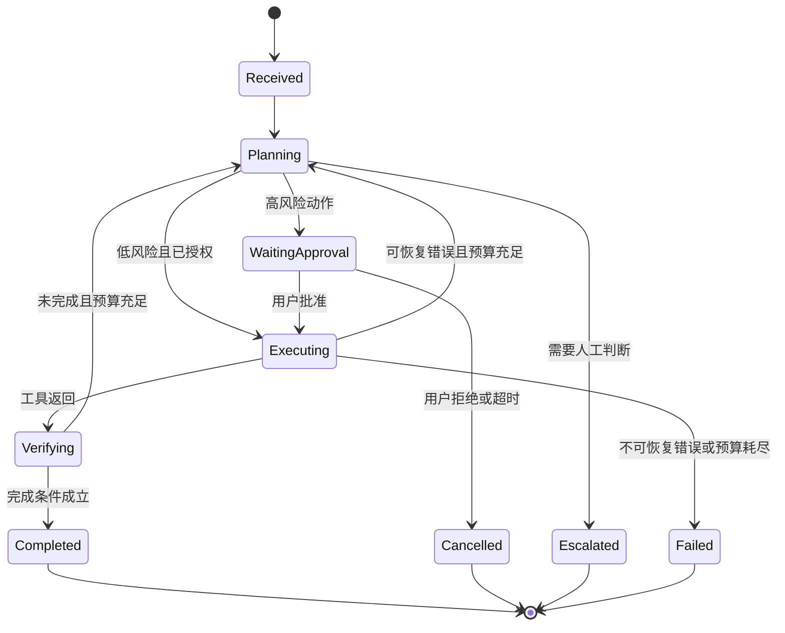

### 9.3 Agent 评测六层（不要只用 RLHF 或 RLAIF）

> **训练方法和评测方法不要混为一谈。** RLHF/RLAIF 是训练手段，不是评测方法。

| 层 | 指标 |
|---|---|
| **模型层** | 知识、推理、代码、多模态、事实性 |
| **工具层** | 工具选择正确率、参数正确率、调用成功率 |
| **任务层** | 端到端完成率、步骤数、耗时、成本 |
| **恢复层** | 超时、网页变化、工具失败后的恢复率 |
| **安全层** | 越权率、提示注入成功率、敏感数据泄漏率 |
| **体验层** | 用户满意度、人工接管率、解释清晰度 |

**自动验证器 vs LLM-as-a-judge**
- 自动验证器适合：代码测试、文件 diff、数据库断言、网页状态
- LLM-as-a-judge 适合：开放文本，但**必须校准偏差 + 抽样人工复核**

**红队数据集**：故意包含越权、诱导泄密、提示注入、边界内容、资源耗尽攻击。

### 9.4 Computer Use 与高风险行为：权限不是"看到了就有"

**原理**：以截图/可访问性树观察，以点击、键入、滚动操作。**本质是 Agent + 工具链，不是模型凭空操作**。

**为什么会被判为高风险**：设备指纹、速度模式、登录地变化、反机器人策略、或高风险操作本身。

**四条原则**
1. **"能看到界面" ≠ "自动拥有权限"**
2. 登录、支付、发帖、删除、上传敏感文件 → **要求人类确认**
3. **验证码不应绕过**；站点有权限制自动化
4. 沙箱、域名白名单、最小权限、动作审计是关键防线

**PM 澄清技巧**：某客户端能否打开外链，取决于该客户端是否启用浏览工具、连接器权限、企业策略、地区与账户设置，**而不是基座模型"智力不够"**。同品牌不同产品入口的工具权限也可能不同。这类"归因正确"的表达在面试里很值钱。

### 9.5 时效信息核验：把"我不知道"说出口

**会变的东西**：模型名称、参数量、价格、上下文长度、许可证、显卡售价、产品能力。

**核验顺序**：官方模型页/技术报告 → 官方 API 文档与价格页 → 官方仓库模型卡 → 可信第三方实测。

**三条纪律**
1. 第三方排行榜是参考，**不等同于业务效果**
2. 未公开参数量时，**不要用估算冒充官方数字**
3. 说不准的时候，**明确标注"无法从公开信息确定"**

> 这三条是 AI PM 的职业素养，也是区分"背过资料"和"做过产品"的分水岭。

---

## 🚀 第 10 章　模块十 · 推理服务 / 性能 / 隐私 / 多 Agent × 产品延伸

### 10.1 推理引擎：四个技术点各自的产品含义

#### 10.1.1 Continuous Batching（连续批处理）

**为什么静态批处理不适合聊天**：请求长度差异巨大，短的等长的，GPU 空转。Continuous Batching 允许已完成的请求退出、新请求插空位，**像地铁上下客**。

**产品含义**：提高利用率和吞吐，但**并发过高会增加排队与单请求延迟**。

**PM 决策**：**把 TTFT 当 SLO（如 P95 TTFT < 1.5s），在满足 TTFT 的前提下尽量追吞吐**。只盯 tokens/s 然后把 batch 拉很大，是典型的产品事故起点。

#### 10.1.2 Paged KV / PagedAttention

**原理**：把 KV Cache 切成固定大小的块，用映射表把逻辑连续 token 映射到物理不连续显存页。**像操作系统分页**。

**产品含义**：解决显存利用率和并发容量。**它不让模型变聪明**，只让它装得下更多并发。

**PM 指标**：并发上限、显存碎片率、KV 驱逐率。

#### 10.1.3 推测解码（Speculative Decoding）

**原理**：草稿模型连续猜若干 token，主模型并行检查，猜对整段接受、错处纠正（输出分布可与主模型一致）。Medusa 加多个预测头提候选树；EAGLE 用主模型 hidden state 预测后续特征提高接受率。MTP 让模型同时预测多个未来位置，先提候选再统一验证。

**产品含义**：**主要缩短输出阶段**，更直接改善"每 token 生成速度"和"总完成时间"。**不要笼统说它显著降低 TTFT**——这是常见错误。

**PM 指标**：接受率（acceptance rate）、ITL/TPOT 改善、质量是否回退（理论上分布一致，但要实测）。

#### 10.1.4 请求排队、负载调度与会话粘性

- GPU 达上限后请求入队（FIFO 或优先级），**过长应超时/拒绝/降级**
- 负载调度选空闲/有模型/显存足够的实例，并**考虑会话粘性**（KV Cache 可能在特定实例上）
- **负载均衡 ≠ 路由**：负载均衡在"能做同一件事的多个实例"间摊流量；路由先判断"应由哪类模型或 Agent 做"

**PM 产品化动作**：排队时给用户可见的反馈（第几位/预计多久），而不是转圈。

### 10.2 网关与可观测指标：AI PM 的仪表盘

#### 10.2.1 流量控制四件套 + 路由

| 概念 | 是什么 | PM 注意 |
|---|---|---|
| RPM | 每分钟请求数 | **RPM 低不代表负载低**（可能少量超长请求） |
| TPM | 每分钟输入+输出 token 总量 | 比 RPM 更贴近真实负载 |
| 并发限制 | 同时执行中的请求数 | 决定排队体验 |
| 负载均衡 | 同能力实例间分流 | — |
| 路由分发 | 按任务/模型版本/地区/成本/权限选后端 | 与负载均衡是两件事 |

**超限策略**：限流 / 排队 / 降级 / 退避重试。**要给用户看得懂的提示**。

#### 10.2.2 性能与稳定性指标

| 指标 | 定义 | 产品解读 |
|---|---|---|
| **TTFT** | 到第一个输出 token 的时间 | 受排队、网络、输入长度、Prefill、缓存影响 → "有没有卡住" |
| **ITL / TPOT** | 相邻 token 间隔 / 每输出 token 时间 | "输出刷得快不快" |
| **TPS** | 每秒 token 数 | **必须注明单请求还是整机**（也可能指 Transactions Per Second） |
| **E2E Latency** | 总时间 | 用户真实等待 |
| 错误率 | 按类型拆分（限流/超时/上下文溢出/工具失败） | **不拆分等于没看** |
| 缓存命中率 | prefix / 语义缓存 | 成本与 TTFT 的杠杆 |
| token 长度分布 | 均值 + P50/P95/P99 | **只报均值会掩盖长尾** |

**纪律**：线上看 P95/P99，不看平均值。中位数好看而 5% 用户等 10 秒，是 AI 产品最常见的体验事故。

#### 10.2.3 日志埋点与链路追踪

**埋点要记**：请求到达、路由结果、Prompt/模型版本、输入输出 token、工具开始/结束、错误码、耗时。

**隐私红线**：**不应无条件永久保存敏感 Prompt**，需脱敏、权限控制、保留期管理。

**链路追踪**：一次任务一个 `trace_id`，各步生成 `span`。**没有 trace_id，"等了 40 秒"这个问题你根本无法归因**——是排队、Prefill、网页工具还是 Decode？

### 10.3 Webhook vs 模型路由：通知与分发是两件事

| | Webhook | 模型路由 |
|---|---|---|
| 回答什么 | 发生了什么，通知谁 | 这件事交给谁处理 |
| 时机 | 事件发生后的回调 | 每次请求时 |
| 例子 | 支付成功、文件上传完成、GitHub 推送 | 简单问答走小模型，编码走专用模型 |
| 工程要点 | 校验签名、防重放、**幂等**（外部可能重复投递） | 按任务类型、能力、价格、延迟、地区、用户等级、负载选择 |

**可串联**：Webhook 把事件送进网关 → 网关用路由器选处理者。

**产品化**：Webhook 让 Agent 能做**异步长任务**（"做完了通知你"），这是提升长任务体验的关键设计。

### 10.4 多 Agent：何时值得拆

**拆法**：角色分工（规划者/执行者/验证者）、并行探索、投票、辩论、任务图（按依赖并行，失败节点可重试或转人工）。

**真相**：**多 Agent 不天然更聪明。** 它会增加 token、延迟、通信歧义和状态冲突。如果任务无法并行、没有独立验证器，拆角色可能只是互相复述。

**值得拆的三条件（全满足才拆）**
1. 子任务边界清楚
2. 能并行（或有明确的独立验证器）
3. 各角色工具或权限不同，且结果可合并、可验证

**设计规范**：通信协议规定消息结构、任务 ID、输入输出 Schema、超时和错误语义；共享状态存放已完成步骤与制品；**角色 Prompt 只定义"你负责什么"，Harness 才负责并发、状态锁、失败恢复和终止条件**。

**PM 指标**：并行收益比（拆开后完成率提升 ÷ token 成本增加）、状态冲突率、合并正确率。

### 10.5 安全与隐私：分层防线

#### 10.5.1 五类风险与防线

| 风险 | 形态 | 防线 |
|---|---|---|
| **Prompt Injection** | 网页/文档伪装系统指令 | 区分指令与不可信数据、工具白名单、输出校验 |
| **越狱** | 诱导绕开规则 | 分层策略、输入输出检测、红队 + 持续回归 |
| **工具越权（Excessive Agency）** | 调用本不该用的能力 | **最小权限、短期凭证、参数校验、人类确认、下游独立校验** |
| **数据泄露** | Prompt/日志/RAG/记忆泄漏敏感信息 | 脱敏、访问控制、租户隔离、保留期、审计 |
| **沙箱逃逸** | 生成代码访问宿主机/网络 | 进程/容器隔离、网络与文件白名单、资源配额 |

**核心信条（强烈建议背下来）**：
> "不要试图造一个不会被骗的模型。要造一个系统：当模型被骗时——它一定会被骗——重要的事情不会崩。"

这是一条系统设计原则，而不是某份标准的原文：提示注入无法只靠一条系统提示彻底根治，重点应从“希望模型永不犯错”转向“即使模型判断错误，权限、验证与审计仍能限制损害范围”。OWASP 对过度自主风险的建议同样强调最小权限、最小功能与人工批准。[^owasp]

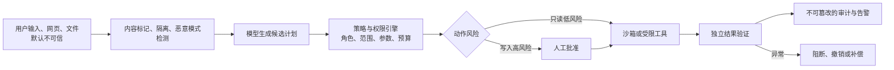

**PM 的可执行清单**
1. 先问"这个 Agent 最坏能做什么"——没有清晰答案就不要上线
2. 每个能力可独立开关（feature flag），**先 observe-only 再 armed**
3. 不确定时 **fail closed**（停下来升级），不是 proceed
4. 回答必须来自可检索的已批准策略，不是开放生成
5. 审计日志记录输入、输出、**授权人与时间戳**，且不可篡改
6. 有明确的书面升级阈值（置信度、金额、缺失证据、保留给人的案例类型）
7. 有人对 Agent 的行为负责（具名）

#### 10.5.2 差分隐私（DP）与联邦学习

| 技术 | 一句话 | 产品权衡 |
|---|---|---|
| **差分隐私** | 裁剪单样本影响并加入校准噪声，使外部难以判断某人数据是否参与 | ε 越小保护越强，但噪声越大、可用性下降。需定义邻接数据集、查询灵敏度、预算累计 |
| **联邦学习** | 数据留本地，各方上传模型更新/受保护统计量由服务器聚合 | 减少原始数据集中，但仍需防更新泄露/恶意参与方/通信攻击 |
| **联邦推理** | 把一次推理拆到多个数据域/设备，各方只交换必要中间结果 | 仍可能泄露中间表示，需配合 MPC/同态加密/TEE/DP；**代价是延迟与工程复杂度上升** |
| **水印** | 在输出嵌入可检测模式用于来源识别 | 可能被改写/翻译/截断削弱，**不能作唯一追责手段** |
| **同态加密** | 允许对密文执行部分计算 | 开销大，并非所有算子高效支持 |

**PM 结论**：隐私技术都是"可用性换保护"的交易，**要按数据敏感度分级使用**，不要一刀切。

### 10.6 十二步链路的埋点地图（可直接抄进 PRD）

| 步 | 必须埋的点 |
|---|---|
| 1 提交 | 目标长度、是否含附件、意图分类 |
| 2 网关 | 鉴权结果、限流命中、排队时长 |
| 3 Harness | 加载的工具数、Skill 命中、记忆召回条数 |
| 4 检索 | 检索耗时、召回条数、Recall（离线）、注入检测结果 |
| 5 上下文 | 各分区 token 数、压缩率、相关率 |
| 6 路由 | 选中模型、路由原因、实例 ID |
| 7 Prefill | 输入 token、prefix 命中与否、Prefill 耗时 |
| 8 Decode | 输出 token、TPOT、工具调用的 Schema 校验结果 |
| 9 工具 | 工具名、耗时、成功率、Observation 大小 |
| 10 验证 | 验证器类型、通过与否、重试次数、人工确认 |
| 11 返回 | E2E 延迟、总成本、trace_id、用户反馈入口曝光 |
| 12 收尾 | KV 释放、写入记忆条数、记忆来源 |

**PM 的验收标准**：任意一次用户投诉"慢/错/贵"，都要能在 5 分钟内用 trace_id 定位到具体步骤。做不到这一点，你的可观测性就是不合格的。

---

## 💬 第 11 章　高频面试题 40 题（含答题框架）

> 使用建议：不要背答案。**每题先自己说 30 秒，再对照"考察点/加分项/踩坑"。** 说不出来说明那个点还没产品化。

### A 组 · 基础概念（10 题）

**A1. 大模型的工作原理是什么？用一句话说清楚。**
> 标准答案：大模型本质是一个"根据上文猜下文"的系统——给定一段文字，预测最可能的下一个 token，反复这个过程生成完整内容。
- 加分：补"Transformer 的自注意力让模型能同时关注输入中的所有位置，这是它理解上下文的关键"。
- 踩坑：说成"有意识的 AI"或"真正理解人类"。**它是统计模型，不是有意识的模型。**

**A2. Token 是什么？PM 为什么要懂它？**
> 词元是模型处理文本的离散单元。一个汉字、单词或标点可能被切成一个或多个词元，具体比例取决于分词器和语言，必须用目标模型的分词工具实测。输入输出通常都会占用上下文和计费额度。
- 加分："我按 session/user/endpoint 拆 token 成本，并维护 token 预算表。"
- 踩坑：把 Token 说成"加密方式"或"安全令牌"。

**A3. 温度（temperature）怎么设？调高会变聪明吗？**
> 温度控制随机性，不控制能力。客服问答 0.1~0.3、代码 0.1~0.2、创意写作 0.7~1.0。
- 加分："生产环境默认低温，因为我们要的是可复现；多样性用多次采样 + 重排来拿，而不是靠高温。"
- 踩坑："调高温度模型更聪明"——它只是更会编。

**A4. 什么是大模型幻觉？产品上怎么缓解？**
> 模型生成看似合理但实际错误的内容，源于概率生成的底层逻辑，**永远无法完全消除**。
- 五件套：RAG 知识库接入 + 溯源标注 + 事实核查 + 风险提示 + 反馈闭环
- 加分："PM 的核心工作不是要求算法彻底消除幻觉，而是**通过产品设计把幻觉的影响降到最低**。"
- 踩坑：说"我们让算法团队把幻觉率降到 0"。

**A5. RAG 和微调怎么选？**
> 三维框架：知识更新频率（常变 → RAG）/ 成本与周期（RAG 更轻）/ 需求类型（缺知识 → RAG，缺行为/风格/格式 → 微调）。
- 加分："**先 Prompt，不行再 RAG，再不行才微调。** 不要用微调注入知识，那是 RAG 的活；不要用 RAG 教行为，那是微调的活。"
- 加分：“我会先比较提示词、检索增强生成、工具与微调的实施和维护总成本，不用固定行业比例代替本项目估算。”
- 踩坑：上来就推荐微调 → 显得没有成本意识。

**A6. 什么是 AI Agent？和普通 LLM 调用有什么区别？**
> 一句话：普通调用是"一问一答"，Agent 是"能规划、能调工具、能多步执行"。Agent = LLM + Harness + MCP + Skill + Memory。
- 加分："**能简单工作流解决的，别上复杂 Agent**"（Anthropic 的核心观点）。这句话体现技术判断力。

**A7. 什么是 Embedding？在 RAG 里起什么作用？**
> 把文本映射成向量，语义相近的文本在向量空间里距离近。RAG 里负责检索环节：问题向量化 → 向量库找最近邻 → 喂给模型生成。
- 加分："Embedding 是独立于 LLM 的模型，换模型要重建索引，所以要做索引版本化与漂移监控。"

**A8. 什么是模型蒸馏？**
> 用大模型（教师）指导小模型（学生）训练，让小模型获得接近大模型的效果。
- 加分："典型用法是让前沿模型生成 1000 条金标准回答，微调小模型，用十分之一成本拿到接近的效果。但要注意合规——蒸馏涉及授权、服务条款与商业秘密。"

**A9. 什么是上下文窗口？为什么重要？**
> 一次能处理的最大 token 数。决定了长文档、多轮对话的上限。
- 加分："**标称窗口 ≠ 可用窗口**。我会测'上下文长度-准确率曲线'找衰减拐点，把拐点当成产品真实能力边界。"
- 踩坑：把"支持 128K"直接写进对外承诺。

**A10. 什么是对齐？RLHF 是什么？**
> 对齐是让模型行为符合人类意图/偏好/安全/目标。RLHF 是其中一种完整流程：人类标注偏好 → 训练奖励模型 → 用强化学习优化。
- 加分："**RLHF 不是 PPO**，前者是流程，后者是算法。而且只有典型 RLHF 管线才需要独立 RM，DPO/ORPO/KTO 都不需要。"

### B 组 · 技术判断（10 题）

**B1. 一个 AI 功能做得好不好，你怎么判断？**
> 三层：模型层（准确率/幻觉率/格式正确率）、链路层（意图识别/工具调用/检索质量/任务成功率）、业务层（CSAT/留存/转化/人工替代率）。加护栏指标（安全违规率、P95、单任务成本）。
- 加分："AI 产品评估没有'一次过'，要持续跑分、持续看 bad case、持续迭代。"

**B2. 怎么评估一个 Agent 产品？**
> 六层（模型/工具/任务/恢复/安全/体验）+ 四个视图（周报/失败分析/轨迹效率/人工触点）。
- 加分："**先建人类专家基线**——不知道熟练人工做同一件事要多久、多少步、多少错误率，就无法判断 Agent 是在提效还是在增负。"
- 加分："端到端成功率要按任务类型细分；95% 单步成功率在 12 步工作流里只有 54%。"

**B3. RAG 效果不好，你怎么排查？**
> 先分离检索与生成。低 Recall + 高忠实度 → 修检索；高 Recall + 低忠实度 → 修提示/模型/上下文格式；答案对但忠实度低 → 模型在用训练数据答题，危险。
- 加分：“我会先建一套覆盖主要任务、不可回答问题和历史坏例的黄金评测集，然后做声明级忠实度判定，并要求评审器返回证据位置供程序和人工抽查。”

**B4. 提示注入是什么？怎么防？**
> 用户输入（或模型读取的网页/文档）里藏指令，操纵模型行为。
- 防线：输入清洗、输出过滤、系统提示加固、**区分可信指令与不可信数据**、工具白名单、最小权限、人类确认。
- 加分："**没有防御是完美的，要按'限制爆炸半径'设计，而不是追求'阻止注入'。** 一个不能发外邮的 Agent，无论提示怎么写都漏不了邮件。"

**B5. 什么是模型漂移？PM 为什么要关心？**
> 模型质量在没有显式改动的情况下变化。原因：供应商静默更新、数据分布变化、用户行为变化。
- 加分："所以 eval 不是一次性的，要定期跑 + 线上监控 + 质量下降告警。我会把 golden set 做成 CI 门禁。"

**B6. 怎么在 GPT / Claude / Gemini / 开源之间选？**
> 五步：定任务类型 → 定质量下限 → 定约束（延迟/成本/出域/部署/合规）→ **用你自己的用例跑对比评测**（不是榜单）→ 定退出方案。
- 加分：“我不会只看榜单追逐最强模型，而会在业务评测集上先选一个达标候选做小流量验证，同时保留切换与回滚能力。”

**B7. 上下文窗口如何影响产品设计？**
> 限制对话历史长度、文档大小、多轮复杂度；成本随上下文增长；长上下文还有 lost in the middle 问题。
- 加分："解法是摘要化、切块、相关性过滤、压缩。**上下文越长不一定越好**——无关信息会稀释注意力。"

**B8. 什么是推理成本？怎么优化？**
> 单次生成消耗的计算资源。优化顺序：① 建基线加可观测 → ② 量化 → ③ 现代引擎（连续批处理 + prefix 缓存）→ ④ 调批处理与 chunked prefill → ⑤ **精简 prompt、限制输出** → ⑥ 推测解码 → ⑦ 大规模才考虑路由与分离部署。
- 加分："**最便宜的优化永远是少算 token。** 很多团队上来就调 kernel、换引擎，但 4000 token 的系统提示用 1000 token 就能达到同样效果时，这一项就压倒其他所有优化。"
- 踩坑：一上来就谈量化/换引擎，忽略 prompt 侧。

**B9. 什么是 KV Cache 和 Prompt Cache？两者一样吗？**
> 不一样。KV Cache 是同一次生成内部跨 decode 步复用 K/V 张量；Prompt/Prefix Cache 是跨请求复用固定前缀预填充后的中间状态；还有业务层的应用缓存。
- 加分："优化产品侧动作：固定内容在前、变化内容在后；不要在提示开头放时间戳/request_id；系统提示版本化；缓存通常是分钟级生命周期。"
- 加分：“我会用真实轨迹计算稳定前缀占比和命中率，再估算前缀缓存对输入成本与首字延迟的改善。”

**B10. 什么是 MoE？对产品意味着什么？**
> 每个 token 只路由激活少数专家。所以**总参数 ≠ 激活参数 ≠ 计算量**。
- 加分："这解释了为什么有些模型能'大模型效果 + 小模型价格'。也意味着**不能只看参数量判断成本**，要按标准任务测实际单价与耗时。"

### C 组 · 系统设计（10 题）

**C1. 设计一款基于 LLM 的智能客服。**
> 四环节：意图识别 → 知识库匹配（RAG）→ 兜底策略（转人工/回拨）→ 反馈闭环（bad case 库）。
- 加分："我会强调每个环节都可能出错。特别是兜底：**不要在用户说'转人工'时才转，那时他已经生气了**——要主动按置信度/重试次数/情绪触发。"
- 加分："转人工必须带上下文摘要，人工第一句话要能接上，而不是让用户从头讲。"

**C2. 设计一个企业知识库问答产品。**
> 检索架构（混合检索 + rerank + 权限过滤）→ 生成（groundedness 约束 + 引用）→ 产品层（溯源 UI、拒答、反馈）。
- 加分："权限必须在**查询时过滤**，不能事后过滤，否则存在泄漏路径。"
- 加分："我会把'不可回答'当成一等公民——golden set 里必须包含文档里没有答案的问题。"

**C3. 做一个 AI 写作功能，指标怎么定？**
> 核心：采纳率（不是生成量）、风格一致性；辅助：编辑比例、字数；护栏：安全违规率。
- 加分："我会额外看'编辑距离'——用户改了多少才用。改得越少说明越好，改得越多说明我们的生成只是在制造工作量。"

**C4. AI 功能延迟太高，怎么排查和优化？**
> 先拆 TTFT 和总时长（两个不同问题）：TTFT 由输入长度、排队、Prefill 决定；总时长由输出长度决定。
- 优化：prefix 缓存、流式输出、压缩上下文、限制输出长度、连续批处理调参、推测解码、语义缓存。
- 加分："每一步都要配质量门禁：量化后质量回退是静默的，没有校准过的评测集，它会以'感觉变差了'的形式在几周后浮现。"

**C5. 怎么设计 AI 功能的降级方案？**
> 三级：模型降级（大→小→规则）、功能降级（AI 生成→模板→人工）、熔断（整体关闭）。
- 加分："配监控告警 + kill switch + 事后复盘。**没有兜底设计的 AI 功能，我不允许上线。**"

**C6. AI 产品的 A/B 测试有什么特殊之处？**
> 特殊性：输出是概率性的（方差大，样本量要重算）、模型版本切换要隔离、**必须有护栏指标**（防止有害输出）、要多维评估不能只看转化率。
- 加分："还要考虑**新奇效应**——新功能上线头几天的活跃不代表留存。我会设一个至少覆盖两周的观察窗。"

**C7. 怎么设计 AI 产品的人工介入机制？**
> 自治四级 + 可逆性原则 + 渐进式授权 + 四个可解释模式 + 三个能反悔机制 + Handoff 三问（何时转、怎么转、转了之后 Agent 做什么）。
- 加分："**转人工不是失败。** 把它当负面指标压低，结果就是 Agent 在搞不定的问题上胡编乱造、反复兜圈子。"

**C8. 怎么设计 AI 产品的定价？**
> 成本结构（API + 基础设施 + 人工审核）→ 用户支付意愿（按效果 vs 按量）→ 竞品定价 → 分层（免费额度/订阅/按功能分级）。
- 加分："我会先算单用户成本：单次 token × 单价 × 日调用次数 × 用户量。算不清这笔账，用户越多亏得越多。"
- 加分："还要有拐点分析——对话量达到多少时 AI 比人工划算。这是跟老板沟通最有效的语言。"

**C9. 做一个 Agent 产品，从 0 到 1 怎么做？**
> 直接背 8.4 的十步清单。
- 加分："我会特别强调第 1 步（写清允许/禁止动作与完成判据）和第 6 步（可验证环境与回放日志）——**这两步决定后面所有迭代能不能做**。"

**C10. 什么情况下不该做 AI 功能？**
> 三问：① 工作流是真的吗（能一句话说清用户、触发、结果）？② 有 ground truth 吗（能判断对错）？③ 现状真的很糟吗（如果今天已经够好，AI 功能的门槛比你想的高）？
- 加分："如果②答不出来，**先做 eval，不要做功能**。这是我见过最贵的学费。"

### D 组 · 行为与项目（10 题）

**D1. 分享一个你主导的 AI 项目。** → STAR + AI 反思，突出技术选型、效果评估、风险控制中的贡献。

**D2. 遇到过 AI 效果不达预期吗？怎么处理？**
> 框架：描述差距 → 归因（数据/模型/提示/链路）→ 措施 → 结果。
- 加分："AI 效果不达预期是常态，关键是快速定位和迭代。"
- 踩坑：说"没遇到过" → 显得没经验或不诚实。

**D3. 分享一次 AI 产品失败的经验。**
> 不要归咎于"AI 不行"，从产品和决策角度反思。诚实 + 深度复盘是加分项。

**D4. 怎么和算法团队协作？**
> 尊重技术判断，不外行指导内行；**把模糊需求转成可量化可验证的指标**；建立共同目标；参与技术评审但不干预实现。
- 加分："具体说法：不要说'生成的内容要更好一点'，要说'用户满意度到 90% 以上、格式合规率 100%、幻觉率降到 5% 以下'。"

**D5. 你怎么管理 AI 产品的不确定性？**
> 设定合理预期（对老板和用户）、建监控体系、设计兜底、小步快跑、管好"实验"和"上线"的边界。

**D6. 怎么向非技术老板汇报 AI 项目？**
> 用业务语言（"准确率提升到 90%"而非"BLEU 提升"）；给"一句话版本"和"详细版本"；诚实说明不确定性。
- 加分：“我会把账换算到同一口径：每个成功任务的模型、检索、工具、基础设施和人工复核成本，对比当前人工流程的工资、管理、返工和服务时段，再做高、中、低流量情景分析。”

**D7. AI 产品需求优先级怎么排？**
> 在传统 RICE 之上加 AI 专属维度：技术可行性、数据准备度、**效果可衡量性**、推理成本、安全合规风险。

**D8. 你怎么判断一个 AI 技术是否成熟可用？**
> 四维度：学术界共识 + 工业界案例、不同场景下的效果方差、成本可控性、生态完善度（工具链/文档/社区）。

**D9. 怎么做 AI 产品竞品分析？**
> 特殊维度：底层模型能力对比、AI 功能的设计方式（Prompt 策略/交互方式）、**自己动手做效果测试**、技术路线差异（RAG vs 微调 vs Agent）、成本结构。

**D10. 你为什么想做 AI 产品经理？**
> 结合自己的具体触发点，说清"AI 重构了 PM 的工作方式"。
- 踩坑：说"因为 AI 火"或"因为工资高"。

### E 组 · 反问环节（5 题，你问面试官的）

> 反问环节是免费加分题。选 2~3 个，按公司阶段挑。

1. **"咱们现在这个 AI 功能，有 golden set / 回归评测集吗？规模大概多少？"** —— 有没有 eval 是判断团队成熟度的金标准。
2. **"目前最让大家头疼的是成功率、成本、还是合规？"** —— 直接定位你的价值落点。
3. **"现在有人类专家做这件事的基线数据吗？"** —— 显示你知道如何衡量价值。
4. **"AI 功能的产品迭代节奏是怎样的？模型升级时怎么回归？"** —— 显示你知道模型漂移。
5. **"团队里 AI 相关的决策是谁做的？PM 在模型选型上有多大话语权？"** —— 判断岗位真实权限。

---

## 💼 第 12 章　作品集与简历：把技术理解写成可验证的证据

> 只在简历上罗列人工智能术语无法证明产品能力。更有说服力的证据是：**一个可演示的产品（可以是个人项目）+ 一份带可复核数字的案例研究 + 一套能现场运行的评测**。

### 12.1 项目描述公式

```
[业务问题] → [我定义的可量化成功标准] → [技术选型与理由] → [关键取舍] → [结果数字] → [护栏指标没有退化]
```

**反面示例**："负责 AI 客服产品，接入大模型，提升了用户满意度。"
**正面示例**：
> 以下为虚构模板，数字只用于演示写法；使用时必须替换为自己真实、可解释的数据。
> 负责某 B 端知识助手的 RAG 链路优化。先定义成功标准为"带引用的答案采纳率 ≥ 80%、幻觉性陈述占比 ≤ 3%"，并建了 320 条 golden set（含 12% 的'文档无答案'用例）。针对 Recall@10 只有 0.62 的问题，依次落地：混合检索（BM25+dense）、cross-encoder 重排、chunk 元数据与权限过滤。上线后 Recall@10 从 0.62 → 0.87，答案采纳率从 54% → 81%，转人工率下降 22%；护栏指标方面 P95 延迟从 4.2s → 3.1s、单任务成本下降 35%，安全违规率为 0。

### 12.2 指标写法的三种形态（全部要有）

| 形态 | 写法 | 例子 |
|---|---|---|
| **绝对值** | 当前水平 | Recall@10 = 0.87 |
| **对比值** | 前后变化 | 采纳率 54% → 81%（+27pp） |
| **护栏值** | 没有退化 | P95 延迟 3.1s（未超 SLO 3.5s）、安全违规率 0 |

**只写对比值不写护栏值，是简历里最常见的减分项**——因为它可能意味着你牺牲了别的东西。

### 12.3 三个必带的 artifact

1. **一个上线过的产品**（哪怕是内部工具 / 开源 side project）：能演示、能讲真实用户反馈
2. **一份带数字的 case study**：按 12.1 的公式写，3~5 页
3. **一套可演示的 eval**：golden set + 跑分脚本 + 结果对比表。**这是最能证明"你真的做过"的东西**

### 12.4 完整案例模板（可直接改编）

> **项目名称**：企业政策问答助手（RAG + Agent）
>
> **背景**：1200 份内部政策文档，员工平均每周花 40 分钟找政策；现有关键词搜索满意度 3.1/5。
>
> **成功判据**：① 答案采纳率 ≥ 75%；② 每条事实性陈述可溯源到具体文档段落；③ 文档里没有答案时必须明确拒答，拒答准确率 ≥ 90%。
>
> **评测集**：320 条 golden set（正常 65% / 边缘 22% / 对抗 13%），人工双人标注，Kappa = 0.78。
>
> **技术路径**：Prompt 基线 → 加 RAG（混合检索）→ 加 rerank → 权限过滤 → 引用校验。**全程未做微调**（成本纪律）。
>
> **关键取舍**：
> - Top-K 从 20 降到 8 + rerank：成本降 40%，Recall@10 反升（噪声减少）
> - 高风险政策（薪酬/合规）设严格 groundedness 阈值，低风险（IT 报修）允许综合
> - 检索为空时明确拒答，而不是让模型自由发挥
>
> **结果**：Recall@10 0.62 → 0.87；采纳率 54% → 81%；转人工率 -22%；P95 延迟 4.2s → 3.1s；单任务成本 -35%。
>
> **护栏**：安全违规率 0；越权检索拦截率 100%；敏感信息泄漏 0 起。
>
> **复盘**：最大的一次教训是早期没做权限过滤，导致一次内测中出现了跨部门文档泄漏，我们随后把 ACL 过滤前移到查询阶段，并加了红队用例。

### 12.5 简历里"技术理解"的写法：不要罗列名词

❌ 错误："熟悉 Transformer、RAG、Agent、微调、RLHF、LoRA、MCP。"
✅ 正确："能独立完成 AI 功能的评测设计与成本建模：建过 300+ 条 golden set 与 CI 回归门禁；能用 Recall@K / groundedness / 单任务成本 / P95 延迟四组指标驱动迭代；主导过一次 RAG→rerank 的选型决策，在质量 +27pp 的同时把单任务成本降 35%。"

**差别在于：前者是"我知道这些词"，后者是"我用这些词做过决策"。**

---

## 🧪 第 13 章　十二类典型产品案例：从原理走到方案

本章不是给出一个“标准答案”，而是演示如何沿着同一条链路思考：**用户任务 → 失败成本 → 最小方案 → 指标 → 诊断 → 优化 → 权衡 → 发布**。所有数字均为写作示例，不代表行业统一门槛。

### 13.1 企业知识库助手：核心不是聊天，而是证据交付

**用户任务**：员工提出一个受权限约束的问题，希望在短时间内得到准确答案、原文证据和适用版本。

**最小闭环**：先做检索增强生成，而不是先做智能体。文档完成解析、切块、元数据和访问控制后，使用关键词与语义混合召回、重排、基于证据生成、逐条引用校验；证据不足时明确拒答。

**指标组合**：

| 层级 | 核心指标 | 为什么不能省略 |
|---|---|---|
| 检索 | 召回率、排序质量、权限过滤正确率 | 没召回或越权召回，生成端无法补救 |
| 生成 | 忠实度、引用支持率、恰当拒答率 | 回答流畅不代表有依据 |
| 体验 | 采纳率、复询率、点开引用率 | 判断用户是否真正相信并使用答案 |
| 业务 | 查找时间下降、重复咨询下降 | 证明产品产生价值而不只是产生文本 |
| 护栏 | 第九十五百分位延迟、单次成功成本、敏感信息泄露率 | 防止质量提升以牺牲体验和安全为代价 |

**诊断顺序**：答案错时，先检查标准答案所需文档是否在召回结果中；在，再检查是否排进最终上下文；仍在，再看模型是否正确使用；最后才考虑更换模型。这个顺序通常比“直接换更强模型”更便宜，也更可解释。

**关键权衡**：召回更多片段提高覆盖，但会增加噪声、延迟与输入成本；严格拒答降低幻觉，却可能降低覆盖率。高风险政策应优先忠实度和正确拒答，低风险的经验类问答可以允许更强的综合与解释。

### 13.2 客服辅助到半自动智能体：先建议，再代办，最后才自动执行

第一阶段只给人工客服推荐回复和证据；第二阶段允许自动填写工单、查询订单，但发送前由人工确认；第三阶段只对高频、低风险、可逆的任务自动执行。不要一开始就把“自主率”当唯一目标。

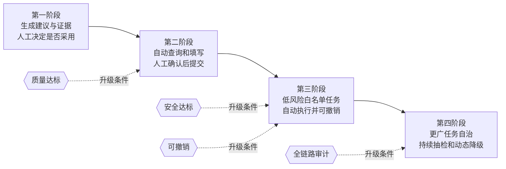

**指标组合**：一次解决率、人工建议采纳率、错误建议率、转人工率、平均处理时长、重复联系率、错误动作率、撤销率、每解决一单的总成本。人工接管率下降只有在一次解决率与质量抽检不下降时才是好消息。

**关键权衡**：自动化提高吞吐，但错误动作的损失高于错误文字。退款、改地址、改账户等写操作必须满足幂等、最小权限、金额或范围上限、二次确认和可回滚；查物流、查营业时间等只读动作可以更早开放。

### 13.3 内容创作助手：优化目标是“减少修改”，不是“生成更多”

创作产品最容易把生成量误当价值。更可信的结果指标是：被保留的段落、用户编辑比例、从草稿到发布的时间、品牌规范通过率、事实核验通过率和最终发布率。

**产品结构**：先让用户选择任务类型、受众、语气、长度与禁区，再提供大纲确认；正文按段生成，允许局部改写；事实性内容触发检索或引用；最终进行品牌、合规与重复性检查。

**关键权衡**：较高随机性增加多样性，也会增加事实和格式波动；过度模板化提高一致性，却会产生机械的“人工智能味”。因此不能只调采样参数，应把“事实正确”和“表达风格”拆开评测：事实层低随机性并带证据，创意层允许多候选，最终由用户选择。

### 13.4 办公与计算机操作智能体：把计划、执行和验证分开

此类产品会真正点击、输入、上传和发送，不能把模型看到界面后给出的判断直接当成执行许可。更安全的结构是：模型提出计划，执行框架进行权限和风险检查，工具执行最小动作，验证器读取外部状态确认结果。

**完成判据示例**：发送邮件不是“模型说已发送”，而是发件箱出现指定收件人、主题与附件的邮件；创建日程不是“工具返回成功”，而是日历中出现满足时区、参与人和时间约束的事件。

**指标组合**：端到端任务成功率、工具选择与参数正确率、误操作率、恢复率、重复副作用率、人工确认率、平均步骤数、每成功任务成本。对付款、删除、公开发布、发送给外部人员等动作，宁可多一次确认，也不要用更高的自治率换不可逆事故。

### 13.5 代码助手：补全与仓库级改造是两种产品

代码补全要求用户敲键时几乎立即给出建议，因此更重视首字延迟、建议采纳率和不打断输入；仓库级改造可以等待更久，但必须检索符号与依赖、修改多个文件、运行编译和测试，并限制变更范围。

**方案骨架**：只检索当前任务相关的文件、符号、调用关系和项目规范；模型先生成计划与补丁；沙箱执行格式化、静态检查、编译和测试；失败时把具体错误反馈给模型，在预算内修复；最后展示差异并由用户确认合入。

**指标组合**：建议采纳率、被撤销比例、编译通过率、测试通过率、端到端任务完成率、平均修复轮次、修改文件数偏差、敏感代码外传事件和每个已接受改动的成本。

**关键权衡**：更多仓库上下文可能提高理解，也会增加延迟、噪声和泄露面；允许模型自由改更多文件提高完成概率，却可能造成超范围变更。产品应以外部测试和差异审查作为完成判据，而不是把“模型输出了代码”算成功。

### 13.6 长文档与合同审阅：漏检和误报的代价不对称

合同、政策和合规审阅通常更怕漏掉关键风险条款，因此第一指标不是笼统准确率，而是关键条款召回率；同时用误报率约束复核负担。

**方案骨架**：按章节、条款和表格结构解析；先用规则与检索定位候选条款，再做结构化抽取和风险分类；输出条款编号、原文位置、风险理由、适用规则与建议动作；高风险结论交专业人员确认。

**指标组合**：关键风险召回率、误报率、引用定位正确率、条款类型识别、专业人员复核时长、单份文档成本和版本适用性错误率。

**关键权衡**：提高召回会多报疑似风险；整份全文送入模型看似简单，却可能受位置效应、输入成本和权限影响。产品上更稳妥的方式是“定位 → 精读 → 汇总”，并保留原文证据供专业人员快速核验。

### 13.7 人工智能搜索与深度研究：分段交付而不是长时间空白

搜索式首答和深度研究报告的等待预算不同。可以先提供经过最小核验的阶段性结果、研究计划与当前证据，再在后台继续多源检索、交叉核验和综合；不要为了制造“快”的感觉先输出未经核验的确定结论。

**指标组合**：首次有用反馈时间、完整报告完成时间、来源覆盖率、引用支持率、来源多样性、过期来源比例、中途取消率、每份报告成本和报告采纳率。

**关键权衡**：检索轮次越多，证据覆盖可能更好，但成本、等待和相互矛盾的来源也增加。终止条件应包含新增信息收益变低、关键问题已有独立来源支持、达到预算或需要用户澄清。

### 13.8 多模态文档处理：字符识别只是第一步

扫描件、发票、表格和图表的处理链路应把图像质量、文字识别、版面还原、字段抽取、业务校验和人工复核分开。这样出现错误时才能知道是“没看清文字”“没理解位置”还是“业务规则不成立”。

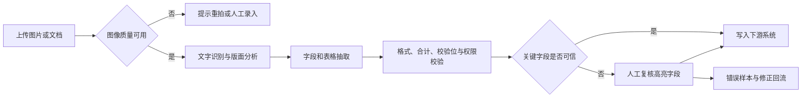

**指标组合**：字符错误率、表格结构还原率、字段级准确率、关键字段漏检率、人工复核率、下游拒绝率、单文档成本和处理时长。文档整体“基本正确”没有意义；金额、税号、日期等字段要分别统计。

### 13.9 自然语言数据分析：能执行的查询不等于算对

用户用自然语言询问数据时，最危险的不是查询报错，而是查询成功但口径、过滤条件或连接关系错误，最终给出看似合理的错误数字。

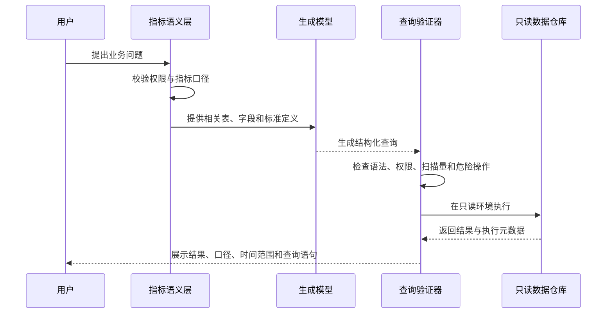

**指标组合**：查询执行成功率、结果正确率、指标口径一致率、权限违规拦截率、异常结果发现率、用户采纳率、扫描数据量和每次查询成本。高价值指标优先固化为语义层定义，模型负责选择而不是临时发明口径。

### 13.10 端侧与私有化部署：卖点是控制权，不是“免费大模型”

客户选择私有化通常是为了数据驻留、审计、离线和内部权限，而不是获得最强模型。产品需要同时交付模型、推理服务、升级机制、监控、权限、日志和支持边界。

**验收方式**：用同一业务评测集比较云端与本地版本，按任务说明质量差距；在客户目标硬件上压测并发和尾部延迟；验证断网、升级失败、日志脱敏和备份恢复；把不支持的能力写进合同和界面。

**指标组合**：目标设备覆盖率、本地任务成功率、与云端质量差、离线可用率、升级成功率、平均恢复时间、敏感数据外传事件、部署工时和每客户维护成本。

**关键权衡**：数据控制换来能力、更新速度与运维成本；混合云能保留复杂能力，但需要逐类说明哪些数据会离开本地并获得明确授权。

### 13.11 多智能体协作：只有独立、可并行、可验证时才拆分

多智能体不是把同一提示复制给多个模型。真正有价值的拆分通常来自：子任务可以并行；角色需要不同工具或权限；存在独立审校者；各自产物能够通过明确接口合并。

**方案骨架**：调度器分配任务与预算；每个角色有有限工具、输入输出结构和完成条件；共享状态只保存已确认事实与制品版本；汇总者不得静默覆盖冲突；最终结果经过独立验证器。

**指标组合**：相对单智能体的质量增益、成本和时长倍数、并行节省时间、子任务失败分布、冲突率、合并正确率和端到端成功率。若没有可测的质量或并行收益，多智能体只是更贵、更慢的单智能体。

### 13.12 成本优化专项：先消除浪费，再接受质量风险

成本优化的正确分母是成功任务，而不是请求。某个方案将单次调用价格减半，却让用户重试翻倍，可能反而更贵。

**推荐顺序**：先修复无限重试和无效工具调用；删除重复或低信号上下文；提高稳定前缀缓存命中；把可延迟任务批处理；用规则和小模型承担分类、过滤和路由；按难度路由模型；优化批处理与显存；最后才考虑更强量化或全面换小模型。

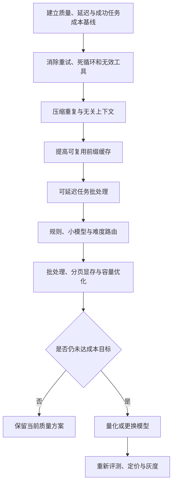

**验证要求**：离线按任务类型和输入长度分层回归；线上同时看采纳、重试、转人工、投诉和尾部延迟；任何有损优化都重新定义能力边界，不能沿用原模型的质量承诺。

---

## 📝 第 14 章　AI 产品需求文档模板：把不确定性写进规格

传统产品需求文档经常只写正常流程；人工智能产品还必须写清能力边界、评测方法、失败模式和回退路径。下面的模板可以直接复制到项目中。

### 14.1 背景、用户与任务

- **目标用户**：谁在什么情境下使用？具有什么权限和专业水平？
- **当前做法**：今天由谁、用什么工具完成？平均时长、错误率、返工率和成本是多少？
- **触发条件**：用户主动发起、系统事件触发，还是定时运行？
- **任务完成定义**：外部世界出现什么可验证状态，才算完成？
- **失败成本**：错误文字、漏答、错误动作、数据泄露分别造成什么后果？
- **不做范围**：明确本版本不支持的用户、数据、动作和风险级别。

### 14.2 成功标准与指标口径卡

每个指标都必须写七项：名称、业务目的、计算公式、分子分母、数据源、统计窗口、切片维度。示例：

| 字段 | 示例写法 |
|---|---|
| 指标名称 | 端到端任务成功率 |
| 业务目的 | 判断用户目标是否真正完成 |
| 计算公式 | 通过外部验证器的任务数 ÷ 发起任务数 |
| 数据源 | 任务日志、数据库状态、用户确认 |
| 统计窗口 | 日监控、周决策，观察第九十五百分位 |
| 切片 | 任务类型、客户、模型版本、工具版本、风险等级 |
| 排除规则 | 用户主动取消且尚未执行的任务单独统计 |

同一份需求文档至少包含：一个北极星指标、两到四个过程指标、成本与延迟护栏、安全与隐私护栏、上线门槛和触发回滚的红线。

### 14.3 系统方案与责任边界

- 输入由谁提供，是否可信，是否含个人信息或机密？
- 提示词、检索、工具、记忆、模型和验证器各承担什么责任？
- 哪些决定允许模型做，哪些必须由规则、权限系统或人工做？
- 每个工具是只读还是写入，是否幂等，失败后如何补偿？
- 上下文从哪里来，优先级如何，超出词元预算时删除什么？
- 采用哪个模型，备选模型是什么，路由依据是什么？
- 日志记录到什么粒度，如何脱敏，保留多久，谁能访问？

### 14.4 交互、信任与失败体验

设计稿不能只有成功页面，还应覆盖：等待中的计划与进度、证据与引用、不确定性说明、需要用户确认的高风险动作、拒答、局部失败、工具超时、模型降级、转人工、撤销和事后审计。

**用户看到的解释应回答三件事**：系统打算做什么；依据了什么；用户还能如何修改、停止或撤销。解释的目的不是展示思维过程，而是帮助用户控制结果。

### 14.5 评测、发布与回滚

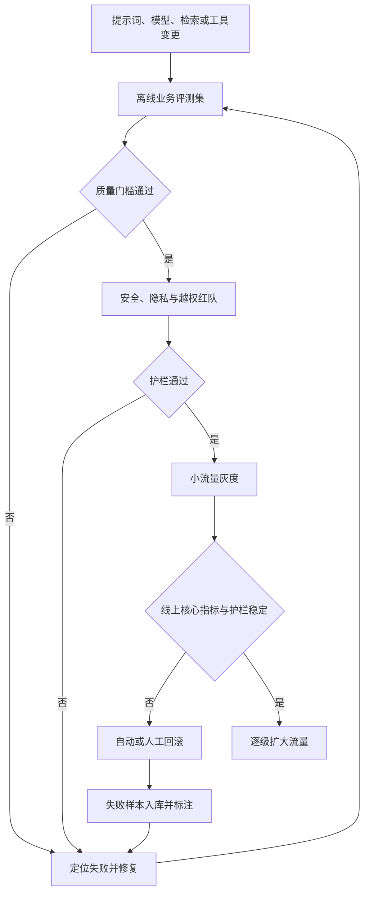

离线评测集应覆盖常规、边界、不可回答、历史坏例和对抗样本；线上采用分阶段灰度，记录模型、提示词、知识库、工具和配置版本。回滚必须能在不重新发布代码的情况下关闭高风险能力、切回稳定模型或降级为规则与人工流程。

### 14.6 可观测性事件表

| 事件 | 必备字段 | 用途 |
|---|---|---|
| task_started | 任务类型、用户权限、风险级别、实验组 | 形成任务分母 |
| retrieval_completed | 查询版本、召回文档、分数、权限结果、耗时 | 定位检索失败 |
| model_completed | 模型版本、提示版本、输入输出词元、耗时、停止原因 | 质量与成本归因 |
| tool_called | 工具、参数摘要、授权结果、耗时、错误码、是否有副作用 | 工具可靠性和越权审计 |
| verification_completed | 验证器、通过与否、失败原因 | 防止“模型自报完成” |
| task_finished | 结果状态、总成本、总时长、步骤数、是否人工接管 | 端到端看板 |
| user_feedback | 采纳、修改、重试、撤销、投诉及原因 | 数据飞轮 |

---

## 🧭 第 15 章　岗位地图：先确定要成为哪一种 AI 产品经理

“AI 产品经理”不是单一岗位。越靠近基础模型和平台，越需要理解评测、推理服务与开发者体验；越靠近应用和行业，越需要理解工作流、用户行为、合规和单位经济。求职准备应绑定目标岗位，否则容易形成“什么都懂一点、没有一项能交付”的简历。

### 15.1 六类岗位的职责与证据

| 岗位方向 | 核心职责 | 必备技术语言 | 核心指标 | 最有说服力的作品 |
|---|---|---|---|---|
| 基础模型产品 | 能力边界、评测、接口、后训练与定价 | 训练、对齐、词元、评测偏差 | 分任务胜率、成本、接口采用 | 评测体系与模型版本决策报告 |
| 智能体平台产品 | 编排、工具协议、状态、权限与可观测 | 状态机、幂等、工具、沙箱、轨迹 | 端到端成功、恢复、工具正确 | 可回放的多步任务系统 |
| 人工智能原生应用 | 找高价值任务并形成使用闭环 | 检索、上下文、交互、路由 | 采纳、留存、成功任务成本 | 有真实用户和实验数据的产品 |
| 垂直行业产品 | 把模型嵌入专业流程和监管边界 | 私有知识、留证、权限、行业规则 | 专业任务正确、合规、续费 | 专家参与的领域评测与工作流 |
| 基础设施与治理产品 | 推理服务、网关、成本、安全和容量 | 首字延迟、吞吐、缓存、限流、风险框架 | 尾部延迟、单位成本、安全事件 | 成本或可靠性治理项目 |
| 产品运营与增长 | 激活、留存、付费、权益和内容治理 | 实验、漏斗、内容安全、计费 | 转化、留存、获客回收、毛利 | 分群实验与定价权益方案 |

**选择方法**：先看自己的可迁移优势。工程背景适合平台与基础设施；行业经验适合垂直应用；增长与商业化经验适合消费应用和运营；研究、数据或开发者生态经验更适合基础模型产品。岗位并无高低，只是问题、语言和证据不同。

### 15.2 各方向的“必备、加分、可以暂缓”

| 方向 | 必备 | 加分 | 可以暂缓 |
|---|---|---|---|
| 基础模型 | 业务评测、版本回归、成本与接口 | 跑过小模型训练、读过关键论文 | 内核和分布式训练调参 |
| 智能体平台 | 状态机、工具契约、权限、恢复、追踪 | 模型上下文协议、安全沙箱 | 深入微调算法 |
| 原生应用 | 场景、检索、交互、实验、单位经济 | 从零到一真实上线与成本优化 | 推理内核细节 |
| 垂直行业 | 行业流程、责任边界、数据和合规 | 专家网络、私有化交付经验 | 通用榜单追踪 |
| 基础设施治理 | 延迟、容量、缓存、路由、成本归属 | 压测、平台开发者体验 | 内容风格微调 |
| 运营增长 | 漏斗、留存、样本量、付费权益、安全治理 | 创作者或社区生态 | 模型训练细节 |

### 15.3 四级能力自评

对模型基础、训练与对齐、检索、智能体、推理成本、评测实验、安全治理、商业化九个能力块分别评分：

- **零级：没接触**——无法用自己的话解释
- **一级：能解释**——知道概念和典型用途
- **二级：能产品化**——能给出用户现象、指标、优化和权衡
- **三级：能交付**——能设计方案、运行评测、解释数据并推动上线

目标岗位的必备能力至少达到二级，并且应有两到三项达到三级。面试前不要平均补课：优先补“目标岗位必备但仍处于零级或一级”的能力。

### 15.4 岗位选择决策图

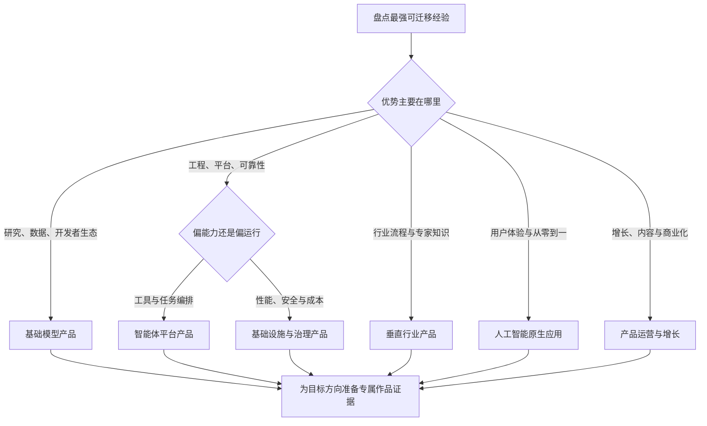

---

## 📊 附录 A　指标字典

> 下表中没有跨行业通用阈值。上线门槛必须从人类基线、历史分布、失败成本、样本量和产品承诺推导；“趋近于零”只用于表达安全目标，不代表现实系统能够证明绝对为零。

| 指标 | 定义 | 口径要点 | 阈值如何确定 | 适用 |
|---|---|---|---|---|
| **任务成功率** | 端到端完成且经独立验证的任务占比 | 必须区分"完成"与"产出"；按任务类型细分 | 对比人类基线并按风险分级 | Agent |
| **自主完成率** | 无需人工干预完成的任务占比 | 与接管率互补 | — | Agent |
| **人工接管率** | 需人工介入的任务占比 | **必须配对质量审计**，低不代表好 | — | Agent/客服 |
| **采纳率** | 生成结果被用户保留/使用的比例 | 比"生成量"有意义得多 | — | 生成类 |
| **编辑距离/编辑比例** | 用户修改幅度 | 越小越好 | — | 写作类 |
| **重生成率** | 用户重新生成的比例 | 首答不满的间接信号 | — | 通用 |
| **复询率** | 需反复追问才拿到满意答案 | 反映理解质量 | — | 问答 |
| **转人工率** | 转人工的比例 | 与解决率、CSAT 一起看 | — | 客服 |
| **解决率** | 问题被真正解决的比例 | 不是"回复了" | 以现有人工或规则流程为基线 | 客服 |
| **准确率** | 输出与标准答案一致程度 | 分任务类型统计 | 由失败成本与专家基线决定 | 通用 |
| **幻觉率** | 含无依据或事实错误的回答占比 | 高风险场景的护栏指标 | 用业务评测集单独标定 | 问答 |
| **忠实度/groundedness** | 有支持的声明 ÷ 事实性声明 | claim-level 判定，judge 需引用校验 | 高风险场景接近 1 | RAG |
| **Recall@K** | 相关文档出现在前 K 个结果的比例 | 检索增强生成的首要诊断指标 | 按问题类型和 K 值分别标定 | RAG |
| **nDCG@K** | 考虑相关等级和排序位置的检索质量 | 需有分级相关性标注 | 与当前检索基线比较 | RAG |
| **MRR** | 首个相关结果的排名倒数均值 | 适合强调首个正确结果位置的任务 | 与当前检索基线比较 | RAG |
| **上下文精确率** | 送入模型的内容中相关的比例 | 噪声指标 | — | RAG |
| **引用正确率** | 引用指向的段落真的支持声明 | 必须单独测 | — | RAG |
| **恰当拒答率** | 文档无答案时正确说"不知道" | 需专门的不可回答用例 | — | RAG |
| **格式正确率** | 输出可被正确解析的比例 | 结构化场景关键 | 写入型流程通常要求接近全部通过，并有失败重试 | 通用 |
| **拒答率** | 模型拒答占比 | **过高说明约束过严** | 监控两侧 | 通用 |
| **一致性分数** | 相同输入多次运行的稳定程度 | 即使低随机性也要多次测 | 按任务是否允许多解来定 | 通用 |
| **TTFT** | 从请求发出到出现第一个输出词元的时间 | 受排队、输入长度、预填充和缓存影响 | 用用户研究与历史分布设服务目标 | 通用 |
| **ITL / TPOT** | 输出词元之间的间隔 / 每个输出词元耗时 | 决定流式输出是否顺滑 | 用阅读体验与终端能力标定 | 通用 |
| **E2E Latency** | 从请求到任务全部完成的总耗时 | 看高百分位而不只看均值 | 按任务复杂度与用户预期分级 | 通用 |
| **TPS** | 每秒 token 数 | **必须注明单请求还是整机** | — | 服务 |
| **缓存命中率** | prefix/语义缓存命中比例 | 与驱逐率一起看 | — | 服务 |
| **token/请求** | 单次请求的输入+输出 token | 看 P50/P95/P99 | — | 成本 |
| **单任务成本** | 完成一个任务的总成本 | 分母是**成功**任务 | — | 成本 |
| **AI 毛利率** | 扣 AI 成本后的毛利 | — | — | 商业 |
| **越权率** | 调用本不该用能力的比例 | 安全层 | 趋近 0 | 安全 |
| **提示注入成功率** | 红队注入用例中成功比例 | 越低越好 | — | 安全 |
| **敏感信息泄漏率** | — | 安全层 | 0 | 安全 |
| **安全拒答率** | 正确拒绝不当请求的比例 | 必须同时看正常请求误拒率 | 按风险类别分别标定 | 安全 |
| **CSAT / NPS** | 用户满意度 / 净推荐值 | 与任务质量指标配对看 | 与产品历史基线和对照组比较 | 通用 |
| **数据驻留合规** | 数据存储与处理是否符合地区及合同要求 | 逐项审计，不用平均分掩盖违规 | 所有适用要求均满足 | 合规 |

---

## 🗺️ 附录 B　技术 → 产品翻译速查表

| 技术概念 | 一句话原理 | 产品语言翻译 | 我该盯的指标 |
|---|---|---|---|
| Tokenizer | 文本切 token | 计费单位与上下文预算 | 压缩率、token P95、截断率 |
| Attention / QKV | 按相关性加权聚合 | 喂什么决定输出什么 | 上下文相关率、证据利用率 |
| 多层多头 | 逐层抽象、多角度观察 | 能力不均匀，要分任务测 | 分任务成功率 |
| 长上下文 | 窗口大但利用不均 | 标称 ≠ 可用，远距离不可靠 | 长度-准确率曲线、中间段利用率 |
| KV Cache | 同请求内复用 K/V | 决定输出速度与并发容量 | TPOT、并发上限、驱逐率 |
| Prompt Cache | 跨请求复用固定前缀 | 固定内容放前面 = 省钱 | 命中率、TTFT、成本 |
| Prefill / Decode | 输入并行算、输出串行生 | TTFT 与总时长是两个问题 | TTFT / TPOT / E2E |
| Continuous Batching | 动态拼批 | 吞吐与单请求延迟的交换 | TTFT P95、吞吐 |
| Paged KV | KV 分页管理 | 装得下更多并发 | 并发上限、碎片率 |
| 推测解码 | 草稿猜、主模型验 | 主要改善输出速度 | 接受率、TPOT |
| 量化 | 降精度省显存 | 端侧/成本的关键，**有质量风险** | 量化前后准确率 delta |
| 蒸馏 | 大模型教小模型 | 用十分之一成本拿接近效果 | 质量保持率、成本下降倍数 |
| LoRA | 低秩增量微调 | 多租户定制的 economics | 单租户成本、隔离正确率 |
| MoE | 每 token 只激活部分专家 | 总参 ≠ 激活参 ≠ 成本 | 单任务成本、激活参数比 |
| SFT | 教格式与指令跟随 | "不听话"的第一解 | 格式正确率、指令遵循率 |
| RLHF/DPO | 学偏好 | "语气/风格/安全"的解法 | 偏好一致性 Kappa、拒答率 |
| RLVR/GRPO | 可验证奖励 | 有标准答案就自动化迭代 | 验证覆盖率、pass rate |
| Reward Model | 把偏好变成分数 | **PM 定义什么是"好"** | Kappa、bad case 转化率 |
| Scaling Law | 性能随资源平滑提升 | 用小实验外推预算 | 业务集得分、成本曲线 |
| RAG | 先查再答 | 减幻觉不是免幻觉 | Recall@K、groundedness、引用正确率 |
| Hybrid Search | BM25 + 向量融合 | 纯向量会漏精确 ID/术语 | Recall@K |
| Rerank | 广召回后精排 | 噪声的主要来源之一 | nDCG@K、上下文精确率 |
| 上下文工程 | 策划最优 token 集合 | **少即是多** | 上下文相关率、token 预算 |
| Agent = LLM+Harness+MCP+Skill+Memory | 五件套分工 | 模型定上限，Harness 定下限 | 端到端成功率、接管率 |
| Harness | 调度运行时代码 | 可靠性的真正来源 | 步数 P99、恢复率、归因覆盖率 |
| MCP | 工具接口标准 | 让别人帮你做集成 | 工具调用成功率、活跃工具数 |
| ReAct | 思考-行动-观察循环 | 步数就是成本也是体验 | 步数 P50/P95/P99、死锁率 |
| Skill / Plugin | 方法论 / 分发包 | 一个是资产，一个是渠道 | 复用率、成功率、维护活跃度 |
| Memory vs Context | 持久化 vs 当次窗口 | 用户以为 AI 记得，要设计 | 记忆精确率、注入 token 增量 |
| ToT / self-judge | 多分支 / 自评 | **能用外部验证就别靠自评** | 验证覆盖率、judge-人工一致率 |
| Computer Use | 看界面 + 操作界面 | 能看到 ≠ 有权限 | 不可逆动作确认率、审计覆盖率 |
| 状态机 / 幂等 | 明确状态与合法转换 | 重试不能重复扣款 | 非法转移次数、重复副作用 |
| JSON Schema | 结构化输出约束 | 保证结构不保证事实 | 解析成功率、字段正确率 |
| 提示注入 | 数据伪装成指令 | **防不住，要限半径** | 注入成功率、越权拦截率 |
| Excessive Agency | 权限超过任务所需 | Agent 安全的头号风险 | 最坏动作清单覆盖率 |
| 差分隐私 | 加校准噪声 | ε 越小越安全、越不可用 | 可用性 delta、预算累计 |
| 多 Agent | 角色分工协作 | 不天然更聪明，成本翻倍 | 并行收益比、状态冲突率 |
| Model Router | 按任务选模型 | 成本与质量的主要杠杆 | 路由准确率、单任务成本 |
| Webhook | 事件回调 | 让 Agent 能做异步长任务 | 幂等率、重复投递率 |
| RPM / TPM / 并发 | 流量控制 | RPM 低不等于负载低 | 限流命中率、排队时长 |

---

## ⚖️ 附录 C　权衡清单 30 条（面试随取随用）

1. 准确率 ↑ → 覆盖率/拒答率 ↓（严格 groundedness 的代价）
2. 模型能力 ↑ → 成本与延迟 ↑
3. 上下文越全 → token 成本与噪声 ↑
4. Top-K ↑ → 召回 ↑ 但噪声与成本 ↑（优选 rerank 而非堆 K）
5. 忠实度 ↑ → 有用性/综合度 ↓（高风险领域选前者）
6. 自治度 ↑ → 可控性与信任风险 ↑（从只读或确认后执行开始，按任务风险渐进授权）
7. 权限开放度 ↑ → 安全面 ↑（最小权限）
8. 工具数量 ↑ → 选择困难与工具描述占用的上下文 ↑（按任务动态装载）
9. 多 Agent ↑ → token 成本、延迟、状态冲突 ↑
10. 微调深度 ↑ → 迭代速度与基座升级红利 ↓
11. 量化程度 ↑ → 显存与成本通常下降，但质量风险上升（不同模型与任务必须实测）
12. 端侧隐私 ↑ → 模型能力 ↓（混合是常态解）
13. 自部署 ↑ → 运维人力、容量规划与闲置成本 ↑（用真实负载做盈亏平衡）
14. 缓存命中率 ↑ → 新鲜度可能下降（相似度、有效期和抽样审计共同控制）
15. 输出多样性 ↑ → 一致性/可复现 ↓
16. 长思考/推理 ↑ → 延迟与成本 ↑（按难度路由）
17. 记忆个性化 ↑ → 隐私风险与上下文膨胀 ↑
18. 实时联网 ↑ → 稳定性、成本、注入风险 ↑（按需不默认）
19. 内容丰富度 ↑ → AI 味与品牌不一致 ↑
20. 上线速度 ↑ → 评测完备度 ↓（Eval-First，但 eval 集可以小）
21. 批处理 ↑ → 吞吐 ↑ 但单请求延迟 ↑（TTFT 当 SLO）
22. 步数上限 ↑ → 复杂任务完成 ↑ 但死循环成本 ↑
23. 重试次数 ↑ → 成功率 ↑ 但成本与用户等待 ↑
24. 人工审核 ↑ → 安全 ↑ 但效率与体验 ↓（按风险分级）
25. 可解释性 ↑ → 可能暴露不该暴露的内容（展示依据而非 raw CoT）
26. 统一通用模型 → 泛化强但行业深度弱
27. 垂类定制 → 精准但维护成本与基座依赖高
28. 开放权重 → 自主可控但运维成本高
29. 差分隐私 ε ↓ → 保护 ↑ 但可用性 ↓
30. 评测集规模 ↑ → 统计稳定性通常提高，但标注与维护成本也上升（优先提高覆盖和代表性）

---

## 📚 附录 D　参考资料与延伸阅读

以下优先保留论文、标准和官方文档。厂商价格、模型能力和服务限制会变化，采购前应再次核对访问当日页面。

**底层原理与训练**

- Vaswani 等人，《Attention Is All You Need》：https://arxiv.org/abs/1706.03762
- Hu 等人，《LoRA: Low-Rank Adaptation of Large Language Models》：https://arxiv.org/abs/2106.09685
- Ouyang 等人，《Training language models to follow instructions with human feedback》：https://arxiv.org/abs/2203.02155
- Rafailov 等人，《Direct Preference Optimization》：https://arxiv.org/abs/2305.18290
- FlashAttention 论文：https://arxiv.org/abs/2205.14135
- vLLM 与分页注意力论文：https://arxiv.org/abs/2309.06180

**检索、智能体与上下文**

- Lewis 等人，《Retrieval-Augmented Generation for Knowledge-Intensive Natural Language Processing》：https://arxiv.org/abs/2005.11401
- RAGAS 检索增强生成评测论文：https://arxiv.org/abs/2309.15217
- Yao 等人，《ReAct: Synergizing Reasoning and Acting in Language Models》：https://arxiv.org/abs/2210.03629
- Liu 等人，《Lost in the Middle》：https://arxiv.org/abs/2307.03172
- Anthropic，《Building Effective Agents》：https://www.anthropic.com/engineering/building-effective-agents
- 模型上下文协议官方规范：https://modelcontextprotocol.io/specification/draft/server/index

**评测、可靠性与性能**

- OpenAI，评测最佳实践：https://developers.openai.com/api/docs/guides/evaluation-best-practices
- OpenAI，延迟优化指南：https://developers.openai.com/api/docs/guides/latency-optimization
- OpenAI，成本优化指南：https://developers.openai.com/api/docs/guides/cost-optimization
- OpenAI，提示词缓存指南：https://developers.openai.com/api/docs/guides/prompt-caching
- vLLM 指标定义：https://docs.vllm.ai/en/latest/design/metrics/
- Google Site Reliability Engineering，服务级目标实施指南：https://sre.google/workbook/implementing-slos/
- Google Site Reliability Engineering，误差预算策略：https://sre.google/workbook/error-budget-policy/

**安全与治理**

- 美国国家标准与技术研究院，人工智能风险管理框架：https://www.nist.gov/itl/ai-risk-management-framework
- 美国国家标准与技术研究院，生成式人工智能风险管理配置文件：https://nvlpubs.nist.gov/nistpubs/ai/NIST.AI.600-1.pdf
- OWASP，大语言模型应用风险中的过度自主：https://genai.owasp.org/llmrisk/llm062025-excessive-agency/
- Greshake 等人，间接提示注入研究：https://arxiv.org/abs/2302.12173
- 模型上下文协议安全政策：https://github.com/modelcontextprotocol/modelcontextprotocol/security

**原始材料**

- 《AI 学习笔记 · 全流程体系化完整版》：https://ai-learning-notes-psi.vercel.app/

[^slo]: Google Site Reliability Engineering，《Implementing SLOs》与《Error Budget Policy》，分别说明如何定义服务级目标和用误差预算约束发布节奏。
[^mcp]: 模型上下文协议官方规范将服务器侧能力分为资源、提示与工具，并要求客户端与服务器通过明确的协议边界协作；支持程度与安全责任仍需逐实现评估。
[^owasp]: OWASP，《Excessive Agency》，https://genai.owasp.org/llmrisk/llm062025-excessive-agency/ 。其缓解建议包括最小权限、最小扩展、对高影响动作进行人工批准，以及在下游系统执行授权。
[^attention]: Vaswani 等人，《Attention Is All You Need》，https://arxiv.org/abs/1706.03762 。
[^lost_middle]: Liu 等人，《Lost in the Middle: How Language Models Use Long Contexts》，https://arxiv.org/abs/2307.03172 。
[^flashattention]: Dao 等人，《FlashAttention: Fast and Memory-Efficient Exact Attention with IO-Awareness》，https://arxiv.org/abs/2205.14135 。
[^lora]: Hu 等人，《LoRA: Low-Rank Adaptation of Large Language Models》，https://arxiv.org/abs/2106.09685 。
[^react]: Yao 等人，《ReAct: Synergizing Reasoning and Acting in Language Models》，https://arxiv.org/abs/2210.03629 。
[^rag]: Lewis 等人，《Retrieval-Augmented Generation for Knowledge-Intensive NLP Tasks》，https://arxiv.org/abs/2005.11401 。

---

## 🔤 附录 E　缩写与术语表：首次阅读不用猜

| 缩写或术语 | 完整名称 | 本文中的直白解释 |
|---|---|---|
| AI | Artificial Intelligence，人工智能 | 本文主要指基于大语言模型的生成式人工智能系统 |
| PM | Product Manager，产品经理 | 定义用户价值、成功标准、优先级和跨团队交付的人 |
| NLP | Natural Language Processing，自然语言处理 | 让计算机处理、理解和生成语言的一组任务与技术 |
| LLM | Large Language Model，大语言模型 | 通过预测后续词元来生成和理解文本的模型 |
| BERT | Bidirectional Encoder Representations from Transformers，双向变换器编码表示 | 典型编码器模型家族，常用于分类、检索和抽取 |
| OCR | Optical Character Recognition，光学字符识别 | 从图片或扫描件中识别字符与位置，不等同于理解版面语义 |
| Token | 词元 | 模型处理和计费的文本小单元，不等同于一个汉字或一个单词 |
| Transformer | 变换器架构 | 以注意力机制为核心的大语言模型基础架构 |
| Attention | 注意力机制 | 根据相关性决定当前生成步骤更重视哪些输入信息 |
| Q、K、V | Query、Key、Value，查询、键、值 | 注意力中用于计算相关性和聚合信息的三类向量 |
| RAG | Retrieval-Augmented Generation，检索增强生成 | 先从外部知识中检索证据，再让模型依据证据回答 |
| Agent | 智能体 | 能在多步循环中规划、调用工具、观察结果并继续行动的系统 |
| Harness | 执行框架或运行时 | 保存状态、限制预算、执行工具、重试、终止和审计的代码层 |
| MCP | Model Context Protocol，模型上下文协议 | 让模型应用用统一方式发现和调用外部资源、提示和工具的协议 |
| SFT | Supervised Fine-Tuning，监督微调 | 用“输入—理想输出”示例教模型稳定完成特定行为 |
| RLHF | Reinforcement Learning from Human Feedback，基于人类反馈的强化学习 | 用人类偏好信号训练模型更符合期望 |
| DPO | Direct Preference Optimization，直接偏好优化 | 直接利用优选与拒选答案对调整模型偏好 |
| LoRA | Low-Rank Adaptation，低秩适配 | 只训练少量附加参数，以较低成本定制模型 |
| MoE | Mixture of Experts，专家混合 | 每次只激活一部分专家子网络的模型结构 |
| KV Cache | Key-Value Cache，键值缓存 | 同一次生成中保存已计算的注意力键和值，避免重复计算 |
| TTFT | Time to First Token，首个词元时间 | 从发起请求到用户看到第一个输出词元的时间 |
| TPOT | Time per Output Token，每个输出词元耗时 | 流式生成阶段每产生一个词元需要的平均时间 |
| E2E Latency | End-to-End Latency，端到端延迟 | 从任务发起到完整结果可用的总时间 |
| P50、P95、P99 | 第五十、九十五、九十九百分位 | 分别代表中位水平、较慢尾部和极慢尾部，不能用平均值替代 |
| SLO | Service Level Objective，服务级目标 | 团队承诺在一个统计周期内达到的可靠性或延迟目标 |
| SLA | Service Level Agreement，服务级协议 | 面向客户的正式服务承诺，通常带合同后果 |
| Recall@K | 前 K 个结果的召回率 | 正确证据是否出现在前 K 个检索结果中 |
| MRR | Mean Reciprocal Rank，平均倒数排名 | 首个正确结果出现得越靠前，分数越高 |
| nDCG | Normalized Discounted Cumulative Gain，归一化折损累计增益 | 同时考虑相关程度和排序位置的检索指标 |
| F1 | Precision 与 Recall 的调和平均 | 同时考虑查得准和查得全，常用于分类与抽取 |
| CSAT | Customer Satisfaction Score，客户满意度 | 用户对某次服务或结果的满意评分 |
| NPS | Net Promoter Score，净推荐值 | 推荐者占比减去贬损者占比，用于衡量推荐倾向 |
| API | Application Programming Interface，应用程序编程接口 | 软件之间调用能力和交换数据的约定 |
| SQL | Structured Query Language，结构化查询语言 | 查询和操作关系型数据库的语言；生产型助手通常默认只读 |
| Text-to-SQL | 自然语言转结构化查询 | 把业务问题翻译为数据库查询，必须验证权限、口径和结果正确性 |
| JSON Schema | JavaScript Object Notation Schema，JSON 结构规范 | 约束结构化输出的字段、类型和必填规则，不保证事实正确 |
| RBAC | Role-Based Access Control，基于角色的访问控制 | 根据用户角色限制其可读取数据与可执行动作 |
| PII | Personally Identifiable Information，个人可识别信息 | 能直接或组合识别个人身份的数据 |
| GPU | Graphics Processing Unit，图形处理器 | 训练与推理常用的并行计算硬件 |
| CUDA | Compute Unified Device Architecture，统一计算设备架构 | 英伟达图形处理器的软件开发与运行生态 |
| FP16 | 16-bit Floating Point，十六位浮点数 | 用十六位精度存储或计算参数，通常比三十二位更省显存 |
| INT8 / 4-bit | 八位整数 / 四位量化 | 用更低位宽表示参数以节省显存和计算，可能带来质量损失 |
| B（参数量） | Billion，十亿 | 例如 7B 表示约七十亿参数，不代表实际激活量或能力排名 |
| GGUF | 一种面向本地推理的模型文件格式 | 常用于保存量化权重与运行元数据 |
| Safetensors | 一种安全、快速加载张量的文件格式 | 避免反序列化任意代码，常用于发布模型权重 |
| BM25 | Best Matching 25，一种关键词排序算法 | 依靠词频和稀有度找包含精确词语的文档 |
| Dense Retrieval | 稠密向量检索 | 把问题和文档映射为向量，按语义相似度召回 |
| Rerank | 重排 | 对初步召回结果使用更精细模型重新排序 |
| ACL | Access Control List，访问控制列表 | 记录谁能访问某个文档、目录或资源 |
| TTL | Time to Live，有效存活时间 | 缓存或临时数据在自动失效前可保留多久 |
| Kappa | 卡帕一致性系数 | 衡量多个标注者超出随机一致的程度，需结合标签分布解释 |
| ROI | Return on Investment，投资回报率 | 净收益相对于投入成本的比例 |
| SOP | Standard Operating Procedure，标准作业程序 | 把重复任务写成可执行、可检查的步骤 |
| UI | User Interface，用户界面 | 用户能看见并操作的界面元素 |
| UX | User Experience，用户体验 | 用户完成任务全过程的感受与效率 |
| SDK | Software Development Kit，软件开发工具包 | 厂商提供给开发者接入能力的代码、工具和文档集合 |
| RPM / TPM | Requests per Minute / Tokens per Minute，每分钟请求数 / 每分钟词元数 | 服务限流与容量规划的两种不同口径 |
| Pass@K | 前 K 次尝试通过率 | 允许最多 K 次生成时至少一次成功的概率或经验比例 |
| Golden Set | 黄金评测集 | 经过人工确认、版本化维护、用于回归比较的代表性样本集合 |
| Bad Case | 失败样本 | 产品未满足预期的真实案例，应进入归因与回归流程 |
| CI | Continuous Integration，持续集成 | 每次变更自动运行构建和回归测试的工程流程 |

---

## 📏 附录 F　行业基准与价格数字：怎样引用才不会误导

新增基准资料中最有价值的不是某个厂商今天的价格，而是它建立了三种证据等级：论文或官方文档的特定实验结果；需要定期刷新的厂商规则与榜单快照；没有统一来源、必须内部实测的经验值。三者不能混为“行业标准”。

### F.1 三类数字的使用规则

| 类型 | 可以怎么用 | 必须同时说明 | 不应该怎么用 |
|---|---|---|---|
| 论文实验结果 | 解释技术机制和收益上限 | 基线、硬件、模型、序列、批量与年份 | 当成自己系统一定能获得的收益 |
| 官方产品规则 | 做当期预算和供应商比较 | 核验日期、模型、区域、套餐与有效期 | 写进长期产品承诺后不再更新 |
| 内部压测结果 | 做本产品容量、服务目标和选型 | 请求分布、并发、版本、样本与置信区间 | 脱离测试环境宣传为行业普遍结论 |
| 社区经验值 | 形成第一轮实验假设 | 明确标注“待实测” | 当作上线门槛或合同依据 |

### F.2 可引用但必须带实验口径的稳定参考

| 技术 | 公开结果 | 正确的产品解读 |
|---|---|---|
| 分页注意力与 vLLM | 原论文报告：在保持相近延迟的实验设置下，吞吐相对当时对比系统提高约二至四倍[^paged_attention] | 证明显存管理会影响容量；不代表所有模型和现代基线都能复现同一倍数 |
| Medusa 推测式解码 | 论文报告 Medusa-1 超过 2.2 倍，Medusa-2 为 2.3 至 3.6 倍[^medusa] | 证明减少串行解码步数可能显著提速；收益仍依赖接受率、批量和训练方式 |
| FlashAttention-2 | 官方实现将 2.0 版本描述为相对第一代约两倍更快，并强调结果随硬件与形状变化[^flash_two] | 可以作为候选内核；仍要做端到端压测，不能把内核倍数等同于产品总延迟倍数 |
| 提示词缓存 | OpenAI 官方说明缓存复用相同前缀，可减少预填充计算；当前支持模型的最低长度、写入价、读取价和有效期因模型而变[^prompt_cache_current] | 稳定内容放前、变化内容放后；用命中率、误失效、新鲜度和实际账单验证 |

> **引用模板**：“在论文的特定模型与硬件设置中，该方法相对论文基线取得约 X 倍改善；我们的产品能否获得相同收益仍需在真实请求分布下压测。”这句话同时保留了证据和边界。

### F.3 不应写成统一行业阈值的项目

- “超过三秒就会流失百分之多少”：缺少跨产品通用的可靠拐点，应通过本产品用户研究和实验确定
- 连续批处理和不同位宽量化的统一加速倍数：实现、硬件、模型和请求分布差异过大
- 某个智能体榜单的当前第一名分数：榜单、任务修订、脚手架和工具都会变化，只能作带日期快照
- 黄金评测集必须多少条、切块必须多少词元、重叠必须多少：应由覆盖、方差、语料结构和失败成本决定
- 客服自助率、幻觉率、人工抽检量的统一门槛：行业、意图和责任风险不同

### F.4 厂商价格与缓存规则的核验卡

每次做预算或面试引用当前价格时，至少保存下面字段：

| 字段 | 为什么需要 |
|---|---|
| 核验日期与官方链接 | 价格和规则会变化 |
| 完整模型与版本 | 同一家不同型号价格不同 |
| 输入、缓存写、缓存读、输出单价 | 不能只抄最便宜的一列 |
| 长上下文和推理附加费 | 可能改变边际成本 |
| 批处理、优先级和峰谷规则 | 时效与折扣存在交换 |
| 缓存最低长度、有效期和路由限制 | 决定能否真实命中 |
| 每分钟请求、每分钟词元和并发限制 | 三种限制会造成不同排队行为 |
| 数据保留、训练使用和区域条款 | 成本不是唯一采购约束 |

预算模型应使用真实请求长度分布，而不是“平均一次对话”。至少分别估算短请求、中位请求和高百分位长请求，并加入重试、工具返回、缓存未命中、人工复核和流量增长情景。

### F.5 基准到产品决策的转换流程

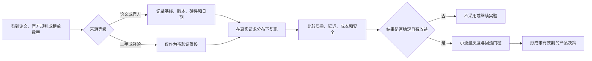

[^paged_attention]: Kwon 等人（2023），《Efficient Memory Management for Large Language Model Serving with PagedAttention》，https://arxiv.org/abs/2309.06180 。
[^medusa]: Cai 等人（2024），《Medusa: Simple LLM Inference Acceleration Framework with Multiple Decoding Heads》，https://arxiv.org/abs/2401.10774 。
[^flash_two]: Dao-AILab，FlashAttention 官方实现与版本说明，https://github.com/Dao-AILab/flash-attention 。
[^prompt_cache_current]: OpenAI，Prompt Caching 官方文档，访问于 2026-10-11，https://developers.openai.com/api/docs/guides/prompt-caching 。

---

## ✅ 最后：三条自查

在你合上这份文档之前，用这三句话给自己打个分：

1. **任何一个技术原理，我能不能在 30 秒内说出它在产品上的现象、指标、优化手段和代价？**
2. **我有没有一个自己的 golden set / 评测案例 / 真实数字，能在面试里讲 3 分钟？**
3. **当面试官说"这个我们做得不错"时，我能不能问出一个他答不上来的问题？**

第 1 条决定你能不能过技术面，第 2 条决定你能不能拿到 offer，第 3 条决定你能不能拿到好的 offer。

> 可以用一句比喻收尾：**模型决定能力上限，执行框架决定可靠性下限。** 对人工智能产品经理来说，理解原理帮助你看见可行边界，理解指标与权衡帮助你把能力稳定地交付给用户。

